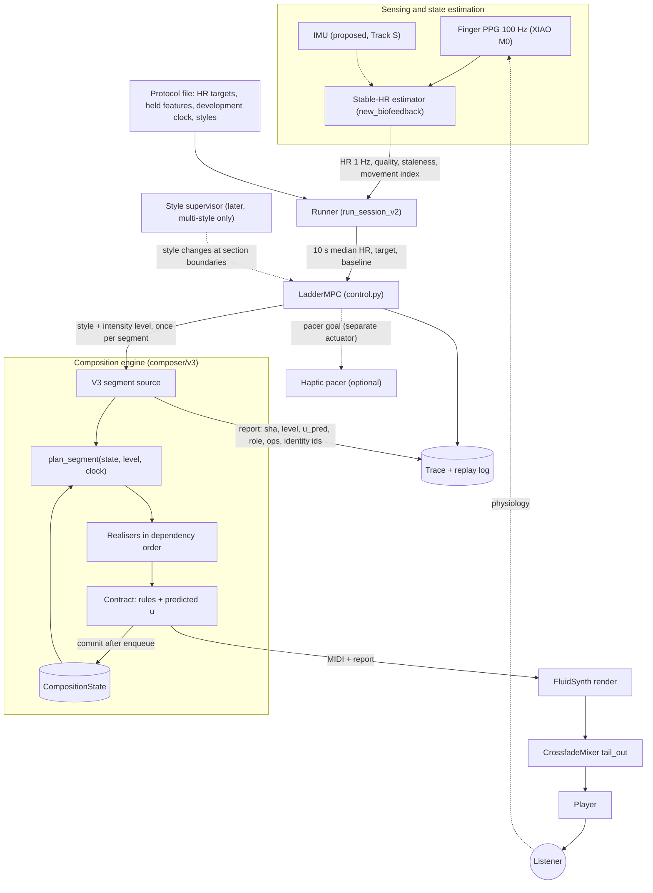

# GrooveGen v3: revised implementation plan

**Status.** Plan only (2026-11-02). No source code, locked generator, stimulus, test, controller
behaviour or experimental artifact was changed. This document supersedes the roadmap sections of
`MUSIC_GENERATION_V3_ARCHITECTURE.md` (2026-11-01). That document's analysis of closed-loop
principles still applies except where section 2.7 corrects it.

**What was reviewed:**
- release `pilot-zero-v2c-locked` (`65f2338`, branch `experiment-music-ratings`);
- the Experiment 1 code on the same branch (`dc2db77`);
- the corpus and analyses on `main`;
- both previous review documents.

**Evidence labels:**

| Label | Meaning |
|---|---|
| **[C]** | Verified in source code at `65f2338` |
| **[R]** | Reproduced by running the locked code, a test, or a measurement script (method stated) |
| **[S]** | Simulated with the **unmodified** `LadderMPC`, live ladder and live configuration against a **synthetic** heart-rate plant (Appendix A). Engineering evidence about the controller's mathematics only; it says nothing about any person's physiology |
| **[P]** | Reported in project documentation, not re-verified here |
| **[E]** | Published evidence |
| **[H]** | Hypothesis requiring investigation |
| **[Eng]** | The reviewer's engineering recommendation. Every number marked [Eng] is provisional |

---

## 1. Executive assessment

1. **The direction is right; the previous document over-reached in three places.**
   - **Structural control channels came before their effects could be identified.** Build,
     sustain, release and transition requests were enabled before anyone could identify their
     physiological effects.
   - **Some controller refinements are not supported.** RLS on achieved `u` is not supported by
     simulation, and a style supervisor is not needed by a single-style prototype.
   - **Acceptance numbers assumed every target was feasible.**
2. **The binding constraint of the closed loop is control authority and identifiability, not the
   generator.**
   - **Controller prior** [C]: 2.5 bpm per unit `u` across the whole ladder, a 1.5 bpm dead zone,
     and a median rung step of 0.020 `u`, i.e. 0.05 bpm at the prior gain.
   - **Drift aliasing** [S]: slow HR drift is absorbed into the RLS gain. With **no** true music
     effect, +0.3 bpm/min of drift yields an estimated gain of 3.4 bpm/u and a 3 bpm "response"
     that looks like successful up-regulation.
   - **Per-session identification is infeasible** [S]: with plausible slow HR fluctuations (SD 2.5
     bpm, an assumption to measure), a 12-minute open-loop block estimates the gain only to
     ±3.5 bpm/u.
   - **Tracking metrics alone cannot show that music works** [S]: time in band is 0.52 with no
     music effect and 0.62 with a 3 bpm/u effect.
   - A better generator will not fix any of this, and must not be expected to.
3. **Recommended staging (closed loop preserved from the first integrated test):**
   - physiology drives the **intensity level every segment**;
   - musical development runs on an **exogenous, deterministic, logged development clock** that
     does not depend on physiology;
   - structural adaptation becomes a **later, separately evaluated channel**. The exogenous
     schedule is itself the natural experiment that estimates whether structural events move HR,
     a prerequisite for using them as a control channel.
4. **Build the generator around a persistent `CompositionState` and a shared `SegmentPlan`
   from the first line of v3 code.** Vocabulary added without coordination would have to be
   rebuilt.
5. **The minimum first integration needs no controller change.**
   - A single-style, five-level hip-hop ladder, with each level's `u` calibrated to the measured
     v2c hip-hop cells, works with the unmodified `LadderMPC`.
   - The runner needs one small opt-in change: it asserts that the source's tempo equals
     `GENRE_CFG`'s tier tempo [C], which a composition-constant tempo would violate.
6. **Feasibility becomes an admission rule.** A composition is used only if every intensity level
   can be realised within tolerance, so the controller never sees an infeasible level. This needs
   no new subsystem.
7. **Two research questions, separated by design.**
   - **RQ-A (music):** open-loop listening with stimuli matched on **measured rendered features**,
     not nominal intents.
   - **RQ-B (closed loop):** same controller, same action space, same protocol, with yoked and sham
     conditions.
8. **First milestone (M1):** baseline, observability and replay (section 14). It changes no
   musical output and makes every later change measurable.

---

## 2. Verified findings and outstanding uncertainties

### 2.1 Generator (from the previous reviews; still valid)

| Finding | Label |
|---|---|
| Lofi/rnb/pop/latin harmony is one 4-chord set per genre as a 4-bar loop played twice. Hip-hop has 5 possible base segments per tier (one after the session key lock); rock 20 | [C][R] |
| Variation is post-hoc and surface-level: drum ops neutral in count, velocity and voice; development pitch-only within ±2 semitones | [C] |
| Gates compare against the v1 generator's seed spread; zero-width envelopes block new material | [C][P] |
| Duplicate cells: calm, lofi, rnb and pop at tiers 1 and 2 give identical MIDI for the same seed | [R] |
| Latin odd bars are out of clave | [R] |
| The hip-hop cell is written "in the exact frame of" two named commercial tracks (familiarity and originality risk) | [C] |

### 2.2 Controller and plant model

| Finding | Label |
|---|---|
| `LadderMPC.step`: ±1 rung candidates, horizon 3 segments, cost = horizon error² + steady-state error² + 0.01·Δrung². **No genre or continuity term** | [C] |
| Plant: FOPDT, `tau=60 s`, `dt=20 s`, 1-segment delay, steady state `HR = base + g·u` with `u ∈ [0, 1]` | [C] |
| RLS: `y = HR − base` on the **previous commanded cell `u`**. Single parameter, **no intercept, no dynamics**, clamped to [0, 12]. Prior 2.5, forgetting 0.97, skipped when `u < 0.05` | [C] |
| Governor: reach = max(2.0, 1.3·ĝ) bpm, so the default `--target-offset-bpm 10` is shrunk to +3.25 bpm at the prior and flagged unreachable | [C] |
| Baseline: median of the last 60 s of a 120 s collection, **before any segment plays**. In the model, `u = 0` (calm) therefore equals the silent baseline, so **targets below the silent baseline are structurally unreachable** | [C] |
| Live configuration: saturation rotation on, band 0.0267 `u`, `stale_hr_policy="hold"`, 1 Hz polling, decision on the 10 s median, `render_lead_s=3.0` | [C] |
| Live ladder (ear order): 27 rungs; median step 0.020 `u`; five zero-`u` steps (calm1/calm2, lofi2/lofi3, pop1/pop2, pop3/hiphop3, rnb3/latin2); maximum 0.232 | [R] |
| A doubled-beat episode inflated ĝ from 2.9 to 11.9; live "collapsed gain" stalls occurred mid-ladder | [P] |

### 2.3 Simulation results (synthetic plant; Appendix A)

The plant is first order (τ 45 s, 5 s delay, 1 bpm sensor noise). 40 seeds per case, 10-minute
sessions, runner timing copied from `run_session_v2`.

| Case | Result | Implication |
|---|---|---|
| A. No music effect (K = 0), drift +0.3 bpm/min, target +10 | ĝ 3.44 ± 0.33; HR rises 3.1 bpm; controller climbs to `u` ≈ 0.68 | Drift masquerades as control and as gain |
| A. K = 3, drift −0.3 | ĝ 0.07 (collapse) | Matches the live "collapsed gain" stalls [P] |
| A. K = 10, no drift | ĝ 9.34; time in ±3 bpm 0.57 | Identification works only with large gain and no drift |
| B. RLS with an intercept | Does not remove the drift bias (K = 0 → 3.89); badly under-estimates K = 10 without drift (3.09) | Not a simple fix: drift and a monotone closed-loop input are confounded |
| C. RLS on achieved vs nominal `u` (within-cell SD 0.05 `u`) | ĝ 9.34 vs 9.34 vs 9.29 | **No measurable benefit.** The previous recommendation is withdrawn (2.7) |
| D. Novelty transients −3 bpm (decay 8 s) at controller-triggered moves | Time in band 0.57 → 0.40 | Structure tied to control degrades tracking |
| D. Same at genre changes (already the case in the current system) | 0.57 → 0.44 | Today's genre switching is a correlated disturbance |
| D. Transients +3 bpm at up-moves | Time in band 0.80 | Correlated novelty can **inflate** apparent control |
| E. Open-loop identification, 2.1-min square wave, raw regressor | K = 3 estimated as 0.51 | Steps shorter than the response time give attenuated estimates |
| E. Lag-aware regressor, correct τ, 12 min | 3.13 ± 0.40 (no fluctuations); ±3.50 with 2.5 bpm fluctuations | **Not identifiable within one session** at plausible noise; pooling needed |
| E. Same, τ assumed 90 s (true 45 s) | 4.43 | The dynamics assumption matters |
| F. Reachable targets (K = 3, +2 bpm) | RMSE 0.71, genre changes 1.8 / 31 | Genre switching mostly reflects **unreachable targets** plus rotation |
| F2/G. With 2.5 bpm fluctuations | 13–15 genre changes / 30 at dead zone 1.5; **6.8–8.9** at dead zone 3.0, with unchanged tracking at K = 3 | The dead zone is below plausible HR noise, so the controller chases noise and causes musical churn |
| H. Fixed gain (no RLS) vs locked RLS | Better or equal under upward drift and noise; **worse** when the true gain is high (K = 10, downward drift: in-band 0.20 vs 1.00), because governor reach is tied to ĝ | No variant dominates. Decide with real noise and gain data |

### 2.4 Runtime and integration

| Finding | Label |
|---|---|
| `generate_segment` for the pretty_midi genres takes 0.2–0.4 ms. Hip-hop (music21) takes 0.08 s warm and 0.46 s on first call, and **no compose warm-up exists** | [R][C] |
| v2c compose (variation + development) took a median of 0.03–0.84 s and a maximum of 1.14 s; RC2 compose + render averaged 0.85 s (maximum 1.44 s) against the 3.0 s lead | [R][P] |
| `run_session_v2` raises if `info['tempo_bpm']` ≠ the `GENRE_CFG` tier tempo, and reads `info['base_seed']` and v2 trace fields | [C] |
| The trace (`TraceRowV2`) has no MIDI hash column; there is no `replay_session.py` (planned in plan §6.5 but absent) | [C] |
| There is **no musical fallback for a missed deadline**; `queued_ahead_s` logs slack and a late render becomes a gap | [C] |
| Render: `fluidsynth -ni -F wav [-O float] -r 44100 -g <gain> sf2 midi`; Rock uses the float, gain and limiter path; master −2.5 dB | [C] |

### 2.5 Sensing and confounds

| Finding | Label |
|---|---|
| Finger PPG (DFRobot analog on a XIAO M0), no IMU. The noise-floor and motion-artifact sections of `SENSOR_NOTES.md` are TODO | [C][P] |
| Haptic motors couple +150–200 counts into raw PPG; "treat haptic-on PPG as contaminated" | [P] |
| The haptic pacer receives the segment HR target and paces from current HR toward it at 6 BPM/min: a second actuator | [C] |
| The older `trace_schema.py` labels a linear HR mapping as "arousal" | [C] |

### 2.6 Corpus

| Finding | Label |
|---|---|
| 122 participants (aged 18–25), 976 participant–song rows. Spotify descriptors (tempo, danceability, energy, valence, artist genres) and questionnaires | [C] |
| 644 tracks with 30 s-preview audio descriptors. **No** transcriptions, chords, drum transcriptions, section annotations or participant groove ratings | [C] |
| Hip-hop/rap/trap tracks (n = 95): folded tempo median 97 BPM (IQR 86–120), onset density 4.8/s, LHL syncopation 0.87 (all tracks 0.73), beat consistency 0.98, percussive ratio 0.32, low-band ratio 0.75 | [R] |
| Prior analysis: danceability weakly predicted (cross-validated R² 0.18); percussive and low-band ratios the strongest predictors; 110–130 BPM tracks score about 9 points higher; no syncopation inverted-U in commercial audio | [P] |
| Experiment 1 participant data are gitignored (`study_data/`) and were not available to this review | [C] |

### 2.7 Corrections to previous conclusions

1. **RLS on achieved `u`** (previous v3, sections 2.4 and 5.1) is **withdrawn as a controller
   change**. Theory: if within-cell deviations are independent of the nominal value (Berkson
   error), regressing on nominal `u` is already unbiased. If "achieved `u`" is itself a noisy
   estimate (classical error), it attenuates the gain. Simulation C shows no benefit. **Log**
   achieved features for analysis; do not feed them to RLS.
2. **Structure requests** were part of phases 2–4 of the previous plan. They are now postponed
   behind exogenous-schedule evidence (section 5.5).
3. **Controller extension** (supervisor, switching penalty, hysteresis) was phase 4. It is now
   postponed: not needed for a single-style prototype; reconsidered with a second style.
4. **"The controller-driven genre-switch rate has not been measured"** is now partly measured in
   simulation [S]:
   - 37–65% of boundaries with the default unreachable +10 bpm target (saturation and rotation);
   - 6–13% with reachable targets and low noise;
   - 39–48% with 2.5 bpm fluctuations at the 1.5 bpm dead zone, falling to 23–31% at 3 bpm.
   - Live rates still need measuring from logged sessions (phase 0).
5. **Acceptance numbers** of the previous phase 2 are replaced (section 7.4): the `u` grid
   0.15–0.90 by 0.05, span ≥ 0.6, predicted `u` within half a tie band in ≥ 95% of segments,
   "0 unplanned recurrence", "30 compositions with no shared hook/loop", and p95 < 0.3 s per
   branch.
6. **`ControlIntent` in phase 1** is deferred. The first prototype's intent is fully described by
   (style, level), which the existing `next_segment(genre, tier)` interface already carries.
7. **Speculative branches** are deferred: not needed at measured generation costs (section 8).
8. **Newly found integration constraint:** the runner's tempo assertion (2.4).
9. **Hip-hop range:** 0.173–0.856 `u`, but hiphop:3 and hiphop:4 are only 0.044 apart, about one
   tie band.

### 2.8 Outstanding uncertainties

| Uncertainty | Why it matters | Resolved by |
|---|---|---|
| True music→HR gain K, its sign and its heterogeneity across people | Determines whether closed-loop efficacy is detectable at all | Pooled open-loop identification blocks (phase 6) and yoked comparisons (RQ-B) |
| HR fluctuation spectrum of the 10 s median at rest and while listening | Sets the dead zone, detectable effects and churn | Existing recordings (phase 0); new rest recordings if insufficient |
| Response time constant and delay | Biases identification (simulation E) | Open-loop step blocks |
| Physiological effect of novelty and structure events (sign, size, latency) | Decides whether structure may become a control channel | Event-locked analysis of the exogenous development clock (phases 5–6) |
| Accuracy of the MIDI-level `u` predictor for new instruments | Runtime checks are only as good as the predictor | Test 0 (section 10) |
| Perceptual distinctness thresholds | Defines "meaningful diversity" | Test A listening |
| Genre typicality of v3 hip-hop with a General MIDI soundfont | A rendering limit, not only a composition limit | Tests A–B listening |
| Movement and haptic effects on HR and PPG quality | Confounds every physiological claim | Track S and protocol design |

---

## 3. Critical evaluation of the seven recommendations

| Recommendation | Verdict | Reasoning | Trade-offs |
|---|---|---|---|
| **A. Generative vocabulary** | **Adopt, modified** | Generators can produce material to a target (density, register, harmonic rhythm), which libraries cannot. Repetition comes mainly from vocabulary (2.1). *Modified:* small principled primitive sets (rhythm cells, harmony grammar, groove templates) inside **sub-style templates** that encode which elements co-occur. Unconstrained combinatorics is the failure mode | Certification shifts from enumeration to statistical sampling plus runtime checks. Coherence needs listening, which rules alone cannot guarantee |
| **B. Persistent composition state** | **Adopt** | Without it, segments are "diverse but disconnected", the failure you describe. It is also what makes intensity changes identity-preserving | One more state object; it must be immutable and logged for replay (section 6.2) |
| **C. Shared planning representation** | **Adopt, as a structured symbolic plan plus a dependency-ordered generation pipeline with pairwise checks** | Independent per-instrument rules do not guarantee coherence (bass against kick, hook against phrase). A general constraint solver or grammar engine is unnecessary: an ordered pipeline (harmony → drums → bass → hook → comping → fills → intensity layers) with local generate-and-test is enough and testable | Less expressive than a solver; acceptable for loop-based genres |
| **D. Progressive control complexity** | **Adopt** (core finding of this review) | Simulation D shows controller-correlated structure disturbs tracking and identification. Simulation E shows per-session identification is already noise-limited for one channel. An exogenous development clock keeps music evolving **and** yields clean data on structure effects. Physiology still changes the music every segment | Early studies cannot claim physiology-driven *structure*. That is the honest scope until evidence exists |
| **E. Feasibility envelopes** | **Adopt, simplified** | Implement as **composition admission** (every level realisable) plus per-segment contract checks. The controller's action space stays a fixed ladder, so no runtime negotiation and no new subsystem | Some generated compositions are rejected; the admission rate becomes a quality metric |
| **F. Identification and robustness evaluation** | **Adopt, before any controller change** | Section 2.3 shows the current estimator is fragile under drift and noise, and no simple variant dominates. Decisions need real noise data and pooled open-loop estimates | Delays controller improvements; avoids building on unidentifiable models |
| **G. Single-genre vertical prototype** | **Adopt: hip-hop** | Worst repetition; already spans `u` 0.17–0.86; prevalent and danceable in the target population (15% of tagged tracks, median Spotify danceability 70); its frozen cell echoes named tracks and has the slowest generation path. The single-style ladder needs no controller change | Hip-hop is harmonically sparse by convention, so pop should be the second style to test harmonic richness |

**Simpler alternatives considered:**
- **Reuse the v2c variation stack with bigger libraries.** Rejected: the stack is built for edits
  that keep counts, velocities and pitch classes fixed, so it cannot carry new identities.
- **Speculative branching from day one.** Rejected: measured costs don't require it.
- **A new MIMO controller.** Rejected: one noisy output at about 3 decisions per minute cannot
  identify several input gains.

---

## 4. Recommended architecture

### 4.1 Target architecture (what v3 grows into)



### 4.2 Minimum architecture to build first (MVP)

```
HR (1 Hz) -> run_session_v2 -> LadderMPC (UNCHANGED) on a 5-level hip-hop ladder ("hiphop_v3", levels 1-5)
          -> V3SegmentSource.next_segment('hiphop_v3', level)      [same API as SessionSegmentSource]
               plan_segment(CompositionState, level, development clock)   -> SegmentPlan
               realise (harmony -> drums -> bass -> hook -> comping -> fills -> layers)
               checks (structural predicates, pairwise rules, predicted u)  -> fallback chain
               returns (PrettyMIDI, info) ; state committed when the segment is enqueued
          -> existing renderer / crossfade / player
Logs: existing trace + appended columns (midi_sha, level, u_pred, role, composition_id, ops)
Absent in MVP: supervisor, structure requests, ControlIntent class, speculative branches, runtime
session monitor (offline only), coupling-compensation subsystem beyond the level calibration.
```

### 4.3 What persists, what is regenerated, who decides

| Element | Persists across segments | Regenerated each segment | Changes with physiology | Set by protocol |
|---|---|---|---|---|
| Style, sub-style, tempo, key, palette | ✓ (per composition) | | Later: style via supervisor | Allowed styles, tempo range |
| Harmonic loop(s), groove identity, bass archetype, motifs | ✓ | | | |
| Section role and form position | ✓ | | | **Development clock** |
| Motif instances and transformations, fills, voicings, ornaments | Memory (ledger) | ✓ | | Operator schedule (clock) |
| Intensity level: layers, densities, dynamics | Last level (for smoothing) | ✓ | **✓ every segment** | Level semantics; held features |
| Exposure ledger, retired identities | ✓ (session) | | | Recurrence policy |
| Seeds | Derived, never stored state | ✓ (derived) | | `stim_seed`, versions |

### 4.4 Complexity budget [Eng]

| Module (new) | Responsibility | Budget |
|---|---|---|
| `groovegen_pilot/composer/v3/state.py` | `CompositionState`, `SegmentPlan`, `SegmentRecord` (frozen dataclasses), canonical hashing, `commit()` | ≤ 300 lines |
| `composer/v3/hiphop.py` | Sub-style templates, generators per role, development operators | ≤ 900 lines |
| `composer/v3/checks.py` | Structural predicates, pairwise rules, predicted-`u` contract, admission | ≤ 300 lines |
| `composer/v3/levels.py` | Level semantics, calibration, compensation | ≤ 200 lines |
| `composer/v3/source.py` | `V3SegmentSource`, development clock, fallback chain, info keys | ≤ 250 lines |
| Offline tools | `replay_session.py`, `session_diversity_metrics.py`, `sim_closed_loop.py`, `hr_noise_profile.py` | ≤ 300 lines each |

- **No new third-party dependencies** (pretty_midi and numpy only; **no music21 in v3**).
- No orchestration framework, no plugin registry, no neural model.
- A module may be split only when a reviewer can name the test that becomes simpler.

### 4.5 The "no new controller classes" rule

The rule is **still useful**. It prevents parallel control laws that fragment validation, and the
MVP needs no controller change. When a second style requires supervision, implement the
supervisor as a **thin policy object that wraps `LadderMPC`** (it chooses the ladder and switch
timing; it is not a new control law). Amend the rule explicitly with the researcher at that
point. Do not work around it with config flags that change the control law's meaning.

---

## 5. Closed-loop control strategy

### 5.1 Channels by stage

| Stage | Physiology changes | Exogenous (protocol, logged) | Entry condition |
|---|---|---|---|
| **1 (MVP)** | Intensity level each segment (layers, per-role density, dynamics; hip-hop calibrated to v2c `u`) | Composition creation, form and development operators; tempo per composition | Phase 5 gates |
| **2 (multi-style)** | + **timing** of style changes via supervisor (reachability, residency, hysteresis) | Composition content | Second style admitted; supervisor simulation non-inferior |
| **3 (conditional)** | + structure requests (section-role changes requested from error trend) | — | Section 5.5 evidence |

### 5.2 Why intensity-only first

- **One channel is already hard to identify.** HR is one noisy output sampled once per segment;
  even a single gain is not identifiable within a session at plausible noise (2.3 E).
- **Control-correlated structure biases and disturbs.** It biases identification and degrades or
  falsely inflates tracking (2.3 D).
- **The music still adapts.** Intensity is realised compositionally: which layers enter, how the
  groove densifies, fills, doubling. Physiology changes what is composed every segment.

### 5.3 Controller policy for the MVP

- `LadderMPC` and `ControllerConfig` **unchanged**.
- New ladder `hiphop_v3` with 5 cells whose `u` equals the measured hip-hop cells (0.173, 0.406,
  0.685, 0.729, 0.856), built directly as a `ladder.Ladder` (the frozen dataclass accepts
  explicit `u`). `_to_ladder` would re-normalise min–max and must not be used for it.
  Saturation rotation is meaningless with one style; run with `--no-saturation-rotation`.
- **Protocol:**
  - targets must lie inside the band the pilot data show to be reachable;
  - report saturated segments separately;
  - `stale_hr_policy="hold"` (existing);
  - haptics off for music-attribution runs.
- **Shadow logging:** log the RLS estimate, the governed target, and a fixed-gain prediction side
  by side for offline comparison. This is analysis output, not control.

### 5.4 Identification strategy

1. **Phase 0:** estimate HR fluctuation SD and correlation time of the 10 s median from existing
   recordings (`ppg_hr_*.csv`, baseline CSVs). Add a 3 × 10-minute rest recording if needed.
2. **Phase 6:** a protocol **identification block** of 12 minutes or more, open loop:
   - pre-registered level steps of ≥ 3 × τ (≥ 2–4 minutes) inside one composition;
   - lag-aware regression with a linear trend;
   - τ bracketed (45 and 90 s) and reported both ways.
3. **Pool** across sessions and participants (mixed model). Per-session estimates are reported
   with their intervals and not used to steer.
4. **Controller decision rule:** change dead zone, gain adaptation or governor only when the
   change is non-inferior in simulation **using the measured noise** and in a developer pilot.
   Candidates:
   - dead zone ≈ the measured SD of the 10 s median;
   - governor reach decoupled from online ĝ;
   - fixed pooled gain with RLS in shadow.
   - None is adopted now.
5. **Futility check:** if the pooled gain's 95% interval upper bound is below about 2 bpm/u
   [Eng], RQ-B efficacy studies are under-powered. Re-scope toward adaptation fidelity and
   perception rather than over-claiming.

### 5.5 Introducing structure requests later

**Prerequisites:**
1. Event-locked analysis of exogenous development events (section starts, composition
   transitions) shows a reliable HR response (sign, size, latency) across participants.
2. The plant model gains a transient-input term for events, validated in simulation with those
   parameters.
3. A pre-registered ablation (structure requests on vs off, same intensity controller) with
   yoked controls.

**Implementation:** add a `structure_request` field. This is when a `ControlIntent` dataclass
becomes justified (section 7.1).

### 5.6 Disturbances and confounds handled by design

| Disturbance | Handling |
|---|---|
| Drift | Baseline per block; counterbalanced order; trend terms in analysis; yoked and sham contrasts |
| Novelty and structure events | Exogenous clock identical across conditions; events logged with timestamps; event-locked analysis |
| Movement | Still protocol for confirmatory physiology; IMU (Track S); signal-quality rejections logged per segment and tested against level |
| Haptics | Off, or a crossed factor; separated motor supply before any haptic-on physiology |
| Below-baseline targets | Not reachable in the current model; take the baseline under a reference music condition if down-regulation is studied [Eng; protocol decision] |

---

## 6. Musical generation strategy

### 6.1 Four separate responsibilities

| Responsibility | Function | Inputs | May change identity? |
|---|---|---|---|
| **Remember** | `commit(state, plan, realised) → state'` appends a `SegmentRecord` to the ledger | Committed segment only | No |
| **Develop** | `plan_segment()` chooses role, operators and motif instances from the development clock and memory | State, clock | Within the composition only |
| **Avoid excessive repetition** | `checks.repetition()` filter: literal-run limit, exposure caps, cross-composition distinctness | Ledger, session state | No (rejects; never generates) |
| **Respond to control** | `levels.realise_level()` sets layers, densities and dynamics | Level | **Never** (identity factors are invariant across levels) |

### 6.2 `CompositionState`

Frozen dataclass; hashable; canonical `repr` → blake2b, reusing `arrangement.H`.

**Identity** (fixed for the composition's lifetime):

| Field | Content |
|---|---|
| `composition_id` | `H(stim_seed, style, ordinal, GEN_VERSION)` |
| `substyle` | `boombap_piano` / `soul_ep` / `minor_strings` |
| `tempo_bpm` | From the hip-hop range 85–96, **constant within the composition** |
| `key` | Tonic pitch class and mode |
| `palette` | Role → GM program, from the sub-style |
| `loop_a`, `loop_b` | Chord symbols with harmonic-rhythm slots; `loop_b` is the contrast loop or None |
| `groove` | Skeleton anchors, kick-variation profile, hat feel, swing (held) |
| `bass` | Archetype parameters: lock-in probability, octave pops, approach style |
| `motifs` | Theme M plus derived motifs, each with its derivation chain |

**Form** (advances on commit):
- `form_plan` (role sequence from the development clock), `section_idx`, `segment_in_section`,
  `segment_ordinal`.

**Memory:**
- `ledger`: tuple of `SegmentRecord(level, role, loop_id, motif_instances[(motif_id, ops)],
  fills, midi_sha)`; bounded, older entries summarised;
- `pending_returns`;
- `exposure`: identity factor → seconds heard.

**`SessionState`** (outside the composition):
- `stim_seed`, protocol and generator versions;
- composition counter;
- retired identity fingerprints (loop, hook, groove profile);
- later: suspended compositions by style.

**Transition rules:**
- the state changes **only** in `commit()`, called when the runner enqueues the segment;
- planning and realisation are pure functions of (state, level, derived seeds);
- seeds come from `H(composition_id, segment_ordinal, purpose, k)`, never from a shared RNG, so
  computing an alternative never perturbs the committed stream.

### 6.3 `SegmentPlan`: the shared representation

**Global** (every role reads it):

| Field | Content |
|---|---|
| Timing | `tempo`, `meter=4/4`, `bars=8` |
| `harmonic_grid` | Per chord slot: bar, start beat, root, quality, function, chord tones, allowed tensions, avoid tones |
| `phrase_map` | 2 phrases × (role statement/answer, cadence slot, motif assignment, turnaround bar) |
| `accent_template` | 16 slots × 8 bars metrical and groove weights; `anchors` (protected kick and snare slots) |
| Arrangement | `section_role`, `level`, `layer_mask` (active roles), `onset_budget[role]` (min/max per bar), `dynamics[role]` |
| Development | `operators` (operator, motif, bars, instrument); `fill_slots` (end of bars 4 and 8); `transition_in` (first segment of a section or composition) |

**Instrument-specific** (realised, not planned): pitches, voicings, articulation and ornament
choices within the plan's budgets.

### 6.4 Generation pipeline and compatibility

Each stage reads the plan and every earlier stage:

| Stage | Generates | Rules |
|---|---|---|
| 1. Harmony grid | From `loop_a`/`loop_b` and role variant (e.g. contrast uses `loop_b` or a bVI/bVII substitution) | |
| 2. Drums | Anchors plus ornament grammar drawn from the accent template within `onset_budget['drums']` | Open-hat choke rule (`variation.open_hat_rings` finding) |
| 3. Bass | From harmony grid and kick onsets | Root (or allowed chord tone) at each chord change, **coincident with a kick**; bass onsets within one 16th of a kick sit exactly on it; approach tones only on weak slots before changes |
| 4. Hook | Motif instance after operators, fitted to harmony | Chord tone or allowed tension on strong slots; non-chord tones resolve by step; statements start at phrase starts unless displaced |
| 5. Comping | Voice-led from the previous chord | Below the hook register (≥ 3 semitones separation on simultaneous onsets); rhythm fills hook rests within budget |
| 6. Fills and transitions | At `fill_slots`; `transition_in` gives staggered entries (drums + bass first, hook at bar 5) | |
| 7. Level layers and dynamics | Per `layer_mask` and `dynamics` | |
| 8. Checks | Structural predicates; pairwise rules (bass–kick, bass–harmony, hook–harmony, hook–comping register, ≤ N simultaneous pitched onsets per slot); predicted `u` | |
| 9. Repair | Bounded resampling of the failing stage only, then the fallback chain (section 8.5) | |

### 6.5 Hip-hop vocabulary

**Sub-style templates** (they encode which elements co-occur):

| Sub-style | Palette | Harmony class | Groove feel |
|---|---|---|---|
| `boombap_piano` | Piano hook, EP or piano comping, finger bass | Minor pedal or two-chord loops (i–bVI, i–iv, i–bVII), 1–2 bars per chord | Boom-bap (kick 1 + varied second kick, snare 2 and 4, 8th/16th hats) |
| `soul_ep` | EP comping, vibraphone or flute hook, finger bass | 7th/9th loops (im9–ivm9, bVImaj7–bVII–im7, iiø7–V7–im7) | Laid-back hats, lighter kick |
| `minor_strings` | String ostinato hook, pad, sub at higher levels | i–bII (Phrygian colour), i–v, pedal with bVI colour | Sparse kick, half-bar accents |

**Generators:**
- **Harmony:** a weighted grammar per sub-style. Loop length 1, 2 or 4 bars; closure (last chord
  leads back to the first); no unintended authentic cadence in default styles.
- **Groove:** anchors plus ornament probabilities by metrical position, constrained by the level's
  `onset_budget`, a pulse-clarity proxy floor and a syncopation band (held).
- **Hook rhythm cells:** 12–20 authored one-bar 16th-grid cells (primitives written for GrooveGen,
  **not** taken from songs). A motif = 2 cells (A + A′ or A + B) × a scale-degree contour from a
  constrained walk landing on chord tones at strong slots, range ≤ an octave.
- **Development operators:** repeat, sequence (follow harmony), contour inversion snapped to
  chord tones, rhythmic displacement by an 8th (checked by the contract), fragmentation,
  augmentation over two bars, neighbour ornament, call→response (new ending and register),
  re-orchestration (hook to another palette instrument), counter-line in hook rests
  (Schoenberg, 1967; Collins & Laney, 2017).

**Corpus use:** hip-hop ranges (2.6) set **priors and bounds**, not rules:
- composition tempo inside 85–96 (idiomatic boom-bap; the corpus median 97 is consistent);
- onset budgets bracket a rendered onset density near 4–5.5/s at mid levels;
- bass-forward balance (low-band ratio about 0.65–0.85 on audio).

Drum position statistics may come from the Groove MIDI Dataset (Gillick et al., 2019; CC BY 4.0).
**Verify its hip-hop coverage after download**; documented style labels show funk, and hip-hop
was not confirmed. Use aggregate position probabilities only, never sequences.

**Copy safety:**
- reject any hook whose pitch-and-onset sequence matches ≥ 6 consecutive notes (transposition
  invariant) of `hiphop_cell._PIANO_RH_TWO_BAR` or any reference material [Eng threshold];
- no excerpt-level extraction from `song_excerpts/`.

### 6.6 Development across segments

- **Development clock (exogenous):** a composition draws one form template (seeded) from a small
  set, for example `[S, V, C, R, V′, C′, R′]` or `[S, V, C, R, coda]`.
  - Sections are 2 segments (16 bars).
  - About 5–7 sections give roughly 3.5–5 minutes at 85–96 BPM.
  - The section role sets which operators apply. **Roles are about thematic function, not
    energy:**

    | Role | Content |
    |---|---|
    | Statement (S) | M on `loop_a` |
    | Variation (V) | M′ via 1–2 operators |
    | Contrast (C) | `loop_b` or a substitution, answer motif N or counter-line; the hook may rest |
    | Return (R) | M restated, possibly re-orchestrated or with a counter-line |
    | Coda | Fragmentation + fill into the next composition |

  - Because roles do not encode energy, the controller's level never conflicts with the form.
    The contract verifies it: at a fixed level, role-to-role predicted `u` stays within
    tolerance (7.4).
- **Composition lifecycle:**
  - created at session start and when a form plan ends;
  - the next composition must differ from retired identities beyond the distinctness threshold;
  - `transition_in` uses staggered entries at the current level.
  - Staggered entrances themselves raise groove ratings (Hurley et al., 2014). They are exogenous,
    logged and identical across conditions.
- **Interruptions** (multi-style, later): a suspended state is kept per style. On return within
  T minutes and below the exposure cap, resume with a Return section; otherwise start a new
  composition. The rule is deterministic.
- **Segment boundaries:**
  - each segment renders separately, so the plan forbids ties across the boundary (notes end by
    bar 8 plus release);
  - pickups live inside the current segment and are level-agnostic, because the next level is
    unknown when they are composed.

### 6.7 Intensity levels and identity retention

**Level semantics** reuse the v2c hip-hop tier semantics, because their energy effects were
measured [C][P]:

| Level | Content |
|---|---|
| L1 | Quarter hats; kick 1; snare; bass; comping; hook in its reduced form (anchor notes of M) |
| L2 | 8th hats; full kick pattern; full hook |
| L3 | 16th hats + open hat; rim ghosts; pickup kicks |
| L4 | + clap layer; sub bass |
| L5 | + pad/strings; counter-line; hook doubling |

Velocity profiles rise with level.

**Invariant across levels** (asserted by test): tempo, key, loop(s), groove anchors, bass
archetype, motif identity (rhythm cells and contour of M), section role.

**Calibration:**
- per composition, bounded velocity and density compensation so predicted `u` per level matches
  its anchor;
- if any level cannot be matched within tolerance, the composition is **not admitted**
  (section 7.3);
- the level's tempo is the composition's tempo, not the v2c tier tempo. Tempo contributes at most
  0.036 `u` across 85–96 BPM [R]; the calibration absorbs it.

### 6.8 Combinatorial vs meaningful diversity

- **Meaningful identity factors:** hook (rhythm cells + contour), harmonic loop (chords + harmonic
  rhythm), groove profile (kick variation, hat feel), palette, tempo and key.
- A new composition must differ from retired ones on **at least two** of hook, loop and palette
  [Eng], with thresholds calibrated by Test A listening.
- Within a session, a hook or loop identity recurs across compositions only as a tagged
  **planned return**.
- Groove-skeleton reuse is expected: it is the style's identity.

### 6.9 Conflict resolution order

1. Hard structural rules.
2. Protocol-held features.
3. The controller's level (within the admitted envelope).
4. Section plan.
5. Development preferences.

A level change never alters identity. If a role and a level seem to clash musically (a Contrast
section at L5), the realiser satisfies both through the layer mask and the operator schedule. If
it cannot, it applies the fallback chain, and the reason is logged.

---

## 7. Controller–generator contract

### 7.1 Inputs

- **MVP:** `next_segment(genre='hiphop_v3', tier=level)`. This is the existing
  `SessionSegmentSource` signature; the source sees no physiology.
- **Later:** a `ControlIntent` dataclass (`style`, `level` or `u_target`, `held`,
  `structure_request`, `novelty_budget`, `mode`) when stage 2 or 3 needs more than (style, level).
  `tests/test_generator_boundary.py` is extended so `composer/v3` imports none of `hr_sources`,
  `serial_ppg_source`, `estimator_hr_source`, `control`.

### 7.2 Outputs (`info` dict → appended trace columns)

| Group | Keys |
|---|---|
| Runner compatibility | `tempo_bpm` (composition tempo; the runner must accept it, see 9-P5), `base_seed` (composition seed, keeps the v2 key) |
| Provenance | `generator='v3'`, `gen_version`, `composition_id`, `substyle`, `section_role`, `section_idx`, `segment_ordinal`, `level` |
| Identity | `loop_id`, `motif_id`, `motif_ops` |
| Measurement and contract | `u_pred`, `u_anchor`, `contract_ok`, `fallback_level`, `fallback_reason` |
| Reproducibility | `midi_sha`, `state_hash_before`, `state_hash_after` |
| Timing | `compose_s` |

### 7.3 Feasibility

| Question | Answer |
|---|---|
| Representation | `LevelSpec(level, u_anchor, u_pred, ok, reasons)` × 5 stored in the composition's admission record; per-role deviations stored too |
| Scope | Level semantics per style; feasibility per composition (admission) and per role (contract) |
| Estimation | Realise each level for the composition's Statement and Contrast plans (milliseconds at pretty_midi speed), predict `u`, run checks. Offline, sample compositions and render to verify (Test 0) |
| Inside `FeatureContract`? | Yes: `checks.admit(composition)` and `checks.segment(plan, midi)`. No separate subsystem |
| Unreachable target | Beyond L1/L5 the controller saturates (existing anti-windup and governor). Later, the supervisor uses per-style envelopes to propose a style change |
| Does the controller see feasibility? | Implicitly: the ladder contains only admitted levels; admission guarantees all five exist |
| Acoustic vs musical feasibility | Acoustic = contract on predicted features. Musical = structural and style-range rules at runtime; perceptual acceptability only by listening (Tests A–C) |
| Does it inform style changes? | Yes, at stage 2 |

### 7.4 Revised numeric criteria (all provisional)

| Criterion | Previous | Revised | Justification / prerequisite |
|---|---|---|---|
| Action space | `u` grid 0.15–0.90 step 0.05 | 5 levels anchored to measured hip-hop `u` | Same action space as a v2c hip-hop-only ladder, enabling a matched generator comparison; finer grids are not resolvable with tie band 0.042 and HR noise |
| Span | Predicted span ≥ 0.6 | Each admitted composition realises all 5 levels | Admission guarantees span; Test 0 must first show the predictor tracks rendered `u` |
| Level accuracy | Predicted within 0.021 in ≥ 95% | Runtime: |u_pred − anchor| ≤ 0.021 for admitted compositions. Audio: mean rendered `u` per level within ±0.042; adjacent levels ordered on audio in 100% of sampled compositions, except L3/L4 (0.044 apart) ≥ 90% | Requires predictor RMSE ≤ 0.03 `u` vs rendered (Test 0); otherwise certify offline by sampling |
| Role neutrality | — | At a fixed level, role-to-role |Δu_pred| ≤ 0.021 | Keeps the development clock from acting as a hidden actuator |
| Admission rate | — | ≥ 70% of sampled compositions | A lower rate means vocabulary and level design conflict |
| Recurrence | 0 unplanned | No hook or loop identity reused across compositions in a 15-minute session except planned returns; thresholds from Test A | "0" was undefined without a calibrated similarity threshold |
| Diversity | 30 compositions with no shared hook/loop | 24 seeded compositions: ≥ 95% of pairs above the identity-distance threshold; triad odd-one-out accuracy above chance (Test A) | Computational and perceptual evidence together |
| Literal repetition | — | Full-arrangement literal repeat ≤ 2 phrases (8 bars); loop repetition inside a section allowed | Hip-hop loops idiomatically; only literal whole-texture runs are penalised |
| Latency | p95 < 0.3 s per branch | Compose p99 ≤ 0.25 s; compose + render p99 ≤ 1.5 s; minimum `queued_ahead_s` ≥ 1.0 s; 0 underruns in 3 × 15 min | Measured headroom (2.4); no speculation needed if met |

### 7.5 Reproducibility

- **MIDI is the scientific record:** `MIDI_n = G(stim_seed, GEN_VERSION, protocol version,
  level_1..n)`. Exact by construction; replay tests compare `midi_sha`.
- **Audio identity** additionally requires:
  - the same `fluidsynth` binary version;
  - the same sf2 sha;
  - identical flags (`-ni -F -r 44100 -g`, the float path for directive MIDI);
  - `MASTER_GAIN_DB`;
  - the crossfade code.
- Record an environment fingerprint (fluidsynth version, OS and architecture, sf2 sha, Python and
  numpy versions) in the session summary. Certify audio identity per environment against a
  reference render set. Cross-platform audio identity is **not** assumed.

---

## 8. Real-time execution strategy

### 8.1 Budget

| Item | Value |
|---|---|
| Hip-hop segment length | 20.0–22.6 s |
| Decision time | 3.0 s before the queue drains |
| Expected v3 compose (pretty_midi + checks + bounded resampling) | Well under 0.25 s, extrapolated from 0.2–0.4 ms base generation [R]; must be measured |
| Render | 0.6–1.7 s live [P] |
| Headroom | ≥ 1 s without speculation [Eng] |

### 8.2 MVP execution

- Compose after the decision, on the existing path.
- **Warm-up:** during the baseline, compose and render (not play) one segment per style in use.
  This removes cold-start costs such as the music21 import (0.46 s measured) and any first-call
  cost of FluidSynth (not measured).
- If measured p99 compose + render exceeds 50% of the lead, the first remedy is
  **`render_lead_s` 3 → 5 s**. This costs 2 s of HR freshness, against a 10 s median window and a
  45–60 s response time constant. Only then consider speculation.

### 8.3 State management

1. Immutable state; pure planning and realisation.
2. `commit()` only after `enqueue_segment` succeeds.
3. Seeds derive from (`composition_id`, ordinal, purpose, k).
4. No shared mutable caches; any cache is keyed by full inputs.
5. **Test:** computing extra hypothetical segments in any order never changes committed MIDI.

### 8.4 Speculative execution (deferred design)

- **Adopt only if** 8.2's remedies miss the latency criterion.
- **Design:**
  - compose the down / hold / up branches (MIDI only) at segment start;
  - render only the chosen branch, or the hold branch first;
  - at most one background render process, lowered priority;
  - never run concurrently with the estimator's critical section (the estimator is a separate
    process; measure its update jitter under load).
- **Acceptance:** committed MIDI byte-identical to the sequential path; estimator 1 Hz update
  jitter unchanged within 50 ms under load [Eng].

### 8.5 Fallback chain (deterministic; every step logged)

1. Resample the failing stage (k ≤ 4 sub-seeds).
2. **Identity-preserving fallback:** the previous segment's plan realised at the requested level,
   with new fills.
3. Previous segment's MIDI at its own level, logged as `fallback_hold`. The controller is told
   the *played* level (the trace logs the actually played level for analysis).
4. **Deadline miss** (render not ready at playback): today this is a gap [C]. MVP: measure only.
   If misses occur, play the pre-rendered hold continuation (requires rendering the hold branch
   early) and log `deadline_fallback`.

### 8.6 Continuity and long sessions

- **Joins:** downbeat-aligned (existing trim and `tail_out`). Within a composition the tempo is
  constant, so the beat grid is continuous. Check loudness steps at same-level joins
  (≤ 1.5 LU [Eng], short-term LUFS).
- **Soak test:** 3 × 30-minute simulated sessions: memory growth bounded (ledger summarised),
  `queued_ahead_s` stable over time, no drift in `play_end` accounting.

---

## 9. Revised implementation roadmap

Each phase lists its objective, files, changes, dependencies, risks, tests, musical validation,
control validation, success and failure criteria, and the gate to the next phase. All v3 work is
opt-in (`--generator v3`, `--ladder hiphop_v3`) under new version strings. Locked fixtures, the
v1/v2/v2c identity tests, Experiment 1 stimuli, ladder files and controller defaults stay
untouched.

### Phase 0: Baseline verification (no behaviour change)

- **Objective:** establish the facts every later decision depends on.
- **Files:**
  - new `groovegen_pilot/session_diversity_metrics.py` (structure-aware metrics: within-
    composition repetition ratio, literal-run length, cross-composition recurrence, exposure dose;
    see the previous v3 document, section 6.4);
  - new `groovegen_pilot/sim_closed_loop.py` (Appendix A harness);
  - new `groovegen_pilot/hr_noise_profile.py` (reads existing `ppg_hr_*.csv` and baseline CSVs);
  - reuse `stimulus_metrics.py`, `pitched_metrics.py`, `simulate_session_v2.py`,
    `summarize_session.py`.
- **Changes:**
  - baseline report for v2c hip-hop and the full ladder;
  - simulation study re-run with **measured** noise parameters;
  - live genre-switch rate from logged sessions.
- **Dependencies:** none.
- **Risks:** recordings insufficient for noise estimation.
- **Tests:**
  - metric determinism;
  - metrics on synthetic MIDI with known repetition structure;
  - `sim_closed_loop` decisions identical to `LadderMPC` driven by `simulate_session_v2` on the
    same HR trace.
- **Musical validation:** none new.
- **Control validation:** noise SD and correlation time; simulated tracking under measured noise.
- **Success:** report with all items, reproducible from scripts.
- **Failure:** noise not estimable, so schedule 3 × 10-minute rest recordings first.
- **Gate:** report reviewed by the researcher.

### Phase 1: Observability and replay (behaviour-identical)

- **Objective:** every segment auditable and replayable before anything new is generated.
- **Files:**
  - `run_session_v2.py`: append-only `TraceRowV2` fields `midi_sha`, `achieved_drum_rate`,
    `achieved_note_rate`, `achieved_vel_mean`, `u_pred_midi`;
  - `session_generator.trace_fields`;
  - `run_pilot_zero.py` summary (environment fingerprint);
  - new `groovegen_pilot/replay_session.py`.
- **Changes:** MIDI hash and achieved MIDI features per segment. Replay regenerates MIDI from the
  trace's (genre, tier) sequence, `stim_seed` and generator, compares hashes, and optionally
  re-renders and compares audio hashes.
- **Dependencies:** phase 0 metrics (achieved-feature code shared).
- **Risks:** accidental behaviour change.
- **Tests:**
  - all existing suites and the 5 gates;
  - `tests/test_session_v2_integration.py`;
  - new `tests/test_replay_session.py`: 3 scripted sessions × {bank, v2c} → 100% MIDI hash match,
    and audio hash match in the same environment;
  - pre-existing trace columns byte-identical to HEAD.
- **Musical / control validation:** none (no output change).
- **Success:** all of the above.
- **Failure:** any pre-existing column or audio byte differs, so revert.
- **Gate:** green suite plus replay report.

### Phase 2: Hip-hop composition core (offline): Test 0 and Test A

- **Objective:** a generator that produces genuinely different, coherent hip-hop compositions,
  coordinated through a shared plan.
- **Files:**
  - new `composer/v3/state.py`, `hiphop.py`, `checks.py`, `source.py` (offline use);
  - new `tests/test_v3_state.py`, `test_v3_hiphop.py`, `test_v3_checks.py`;
  - extend `measure_hook_levels.py` profiles for the new palette instruments (sha-pinned);
  - an audition path: `audition_v2.py --generator v3` or a small `audition_v3.py`.
- **Changes:**
  - `CompositionState` (identity + Statement only);
  - `SegmentPlan`;
  - the stage 1–9 pipeline;
  - three sub-styles;
  - copy check;
  - MIDI-level `u` predictor (drum onset rate and tempo exact; loudness from level tables;
    brightness class).
- **Dependencies:** phase 1.
- **Risks:** low typicality with General MIDI timbres; incoherent combinations.
- **Tests:**
  - determinism;
  - 0 structural violations over 24 seeds × 5 levels;
  - pairwise-rule pass rates reported;
  - identity invariance across levels;
  - copy check;
  - import boundary.
- **Musical validation:** Test 0 (predictor vs rendered `u`) and Test A (section 10).
- **Success:** section 10 criteria for Tests 0 and A.
- **Failure:**
  - predictor RMSE > 0.03 `u`, so switch runtime checks to offline certification and re-plan
    7.4;
  - Test A triads at chance, or typicality clearly below v2c, so revise sub-styles and
    vocabulary before proceeding.
- **Gate:** Tests 0 and A passed.

### Phase 3: Controlled variation within a composition (offline): Test B

- **Objective:** change level without losing identity, and show admission works.
- **Files:** new `composer/v3/levels.py`; `checks.admit`.
- **Changes:** level semantics (6.7), per-composition calibration, admission, role-neutrality
  check.
- **Dependencies:** phase 2.
- **Risks:** low admission rate; levels audibly mismatched to energy anchors.
- **Tests:**
  - level monotonicity of predicted `u`;
  - admission rate ≥ 70%;
  - invariants across levels;
  - role neutrality (7.4).
- **Musical validation:** Test B.
- **Success:** Test B criteria.
- **Failure:** identity judged lost across levels, or levels not ordered on audio, so redesign
  the level semantics.
- **Gate:** Test B passed.

### Phase 4: Development across segments (offline): Test C

- **Objective:** coherent evolution over minutes.
- **Files:** `state.py` (form, ledger, commit), `hiphop.py` (operators, roles, transitions),
  `source.py` (development clock, composition lifecycle).
- **Changes:** form templates; operators; Contrast loops; returns; coda and `transition_in`;
  cross-composition distinctness.
- **Dependencies:** phase 3.
- **Risks:** development audible as randomness; roles leaking energy.
- **Tests:**
  - commit-only state changes;
  - replay of 15-minute level sequences byte-identical;
  - repetition metrics within band;
  - role neutrality over whole compositions.
- **Musical validation:** Test C.
- **Success:** Test C criteria.
- **Failure:** listeners do not perceive returns or development, so revise operators and form
  before integration.
- **Gate:** Test C passed.

### Phase 5: Real-time integration (engineering): Test D

- **Objective:** v3 under the unmodified controller with real timing.
- **Files:**
  - `run_session_v2.py`: opt-in `segment_source.authoritative_tempo` (use `info['tempo_bpm']`
    instead of asserting equality) and v3 info → trace;
  - `run_pilot_zero.py`: `--generator v3`, `--ladder hiphop_v3` (direct `Ladder` construction),
    warm-up during baseline;
  - `session_generator.py` (v3 source factory);
  - `simulate_session_v2.py` (v3 support).
- **Dependencies:** phase 4; Track S for any physiology-quality claims.
- **Risks:** timing regressions; tempo plumbing errors in trim and crossfade.
- **Tests:**
  - `tests/test_session_v3_integration.py`: default paths byte-identical; v3 sessions replay
    identically; trim uses composition tempo;
  - latency criteria (7.4);
  - 3 × 30-minute soak.
- **Musical validation:** continuity listening at same-level joins and level changes.
- **Control validation:** Test D2 developer runs with a v2c hip-hop-only ladder vs v3 on the same
  controller; adaptation fidelity (played level = commanded level unless logged fallback;
  rendered `u` per level within 7.4).
- **Success:** Test D.
- **Failure:** underruns or fallback rate > 2% of segments [Eng], so profile and apply 8.2
  remedies.
- **Gate:** Test D passed plus a protocol amendment for any participant use.

### Phase 6: Controller refinement and identification (evidence-gated)

- **Objective:** decide controller changes with data, not by design preference.
- **Files:** `control.py` (only via a versioned `ControllerConfig` option or a wrapper, per 4.5),
  `sim_closed_loop.py`, protocol identification block.
- **Changes:**
  - candidates in 5.4;
  - multi-style supervisor only when a second style passes phases 2–5;
  - structure requests only after 5.5.
- **Dependencies:** phases 0 and 5 data.
- **Risks:** over-fitting the controller to the developer.
- **Tests:**
  - every existing controller test unchanged with defaults;
  - new option tests;
  - simulation with **measured** noise: non-inferior tracking (margin pre-set from phase 0
    variance), fewer musical changes.
- **Musical validation:** churn (level and style changes per minute) and continuity ratings.
- **Control validation:** pooled identification report; yoked comparison in pilots.
- **Success:** a pre-registered decision memo per change.
- **Failure:** no candidate non-inferior, so keep the locked controller.
- **Gate:** researcher sign-off.

### Phase 7: Evaluation and expansion

- **Contents:** RQ-A listening study; RQ-B closed-loop pilot (section 11); pop as the second
  style (harmonic grammar informed by pop/rock harmony corpora); multi-style ladder;
  re-measurement with frozen v1 z-parameters.
- **Gate per study:** a pre-registration and an approved protocol.

### Track S (parallel): sensing and confounds

- **Work:**
  - IMU channel (a XIAO variant with an on-board IMU, or a wrist accelerometer) logged with PPG;
  - complete the `SENSOR_NOTES.md` noise-floor and motion-artifact sections;
  - separate the haptic motor supply;
  - HR reference-device comparison.
- **Success:** artifact rate vs movement characterised; haptic-on PPG uncontaminated.

---

## 10. First proof-of-concept specification

The proposed Tests A–D are the right core. Add **Test 0**: without it, every "same intensity"
claim rests on an unvalidated proxy. Add **Test B′** (matched-feature A/B against v2c): it is the
real basis of RQ-A.

| Test | Setup | Convincing evidence | Revise the architecture if |
|---|---|---|---|
| **0. Measurement chain** | Render v2c hip-hop:1–5 (8 seeds each) and 24 v3 compositions × 5 levels with the live renderer; compute `music_features_measured` `u`; compare with MIDI-predicted `u` | Predictor RMSE ≤ 0.03 `u` and level ordering reproduced on audio | RMSE > 0.03: runtime checks cannot certify, so move certification offline and widen tolerances with justification |
| **A. Musical diversity** | 12 compositions (seeds) at L3, 2-segment excerpts (32 bars ≈ 85 s); the same for v2c hip-hop:3 visits | Computational: identity factors distinct (≥ 95% of pairs above threshold); 0 structural violations. Perceptual (≥ 12 external listeners, blind): triad odd-one-out accuracy for v3–v3 above chance (1/3) and above v2c–v2c; typicality not lower than v2c beyond a pre-set margin; 2–3 musicians' rubric (harmony, groove, hook, arrangement) | Triads near chance (compositions sound alike), typicality clearly lower, or the expert rubric flags incoherence |
| **B. Adaptive control within a composition** | 3 compositions; sequences L1→L5, L5→L1, L2→L4→L2→L5; 1 segment per level | Invariants hold (test); rendered `u` per level within 7.4; listeners judge "same song" for ≥ 80% of within-composition level pairs vs different-composition pairs [Eng], and the direction of energy change matches the commanded level | Identity judged lost, energy direction wrong, or experts flag implausible arrangements used to hit targets |
| **B′. Matched-feature comparison** | v2c hip-hop:k vs v3 L_k at matched rendered LUFS (±0.5 LU), drum onset rate (±5%), tempo (v3 composition tempo set to the v2c tier tempo for this test) | Matching achieved, with residuals reported. This is the stimulus set for RQ-A | Matching impossible without breaking v3 rules, so revisit level semantics |
| **C. Multi-segment development** | 6–10 minutes driven by fixed level sequences (a scripted random walk ±1 and a developer HR-derived sequence) | Operators applied as scheduled; within-composition repetition metrics within band; listeners (≥ 12) mark "new idea" and "return" events with above-chance agreement with the plan; coherence ratings above v2c dwell | Returns unrecognised; development heard as random; fatigue or boredom ratings no better than v2c |
| **D1. Offline real-time** | `simulate_session_v2` with the v3 source, synthetic plant and recorded HR traces; 3 × 15-minute and 3 × 30-minute runs | 0 underruns; latency criteria; replay byte-identical; fallback rate ≤ 2% | Any underrun or replay mismatch |
| **D2. Live engineering** | Developer sessions, unmodified `LadderMPC` on `hiphop_v3` vs v2c hip-hop-only ladder; haptics off; still protocol | Played level = commanded level (except logged fallbacks); rendered `u` within tolerance; continuity rated acceptable; PPG quality unchanged vs v2c | Timing, fidelity or quality failures. **Not** a test of physiological efficacy |

---

## 11. Scientific evaluation framework

### 11.1 Four layers

| Layer | Measures | Evidence type |
|---|---|---|
| Software | Determinism, replay, latency, continuity, contract and admission, fallback rate | Automated |
| Musical | Structural predicates, pairwise rules, identity distances, repetition metrics, expert rubric | Automated + expert |
| Perceptual | Repetition, coherence, typicality, liking, EGQ urge-to-move and pleasure (Senn et al., 2020), perceived energy, boredom over time (Fahlman et al., 2013) | Listeners |
| Closed loop | Tracking RMSE, time in band, settling, overshoot, response latency (cross-correlation lag), commanded vs realised level and `u`, signal quality, movement, churn | Physiological studies with yoked and sham controls |

### 11.2 RQ-A: musical generation (open loop)

- **Matching:** stimuli are matched on **measured rendered features** per level (Test B′), not on
  nominal intents, because the generators interpret commands differently.
  - **Matched:** LUFS, drum onset rate, tempo, plus pulse clarity and syncopation reported.
  - **Allowed to differ:** harmony, motif, development, arrangement detail, palette timbre (with
    centroid matched or reported).
- **Design:**
  - within subject; counterbalanced (Latin square of generator × trajectory × seed); new seeds per
    participant;
  - long passages (6–8 minutes) for repetition and fatigue; short excerpts for typicality and EGQ.
- **Analysis:** mixed models (participant and stimulus random effects).
  - Superiority for perceived repetition.
  - TOST equivalence for EGQ and perceived energy (danceability and energy preserved).
  - Non-inferiority for coherence and typicality.
  - All margins pre-registered.
- **Illustrative sample sizes** (normal approximation, α = .05, power .80; effect sizes are
  assumptions):

  | Test | Effect or margin | n |
  |---|---|---|
  | Paired superiority | dz = 0.5 | ≈ 33 |
  | Paired superiority | dz = 0.3 | ≈ 89 |
  | Paired TOST | ±0.5 SD | ≈ 36 |
  | Paired TOST | ±0.4 SD | ≈ 56 |
  | Paired TOST | ±0.3 SD | ≈ 97 |

  Run a pilot (n ≈ 10–12) to estimate variances first. The Qualtrics pipeline on
  `experiment-music-ratings` can be reused.

### 11.3 RQ-B: closed-loop adaptation

- **Hold constant:** the same controller (locked `LadderMPC`), the same action space (5 levels,
  same `u`), and the same protocol (reachable targets, durations, haptics off, still posture).
- **Conditions** (within subject, separate blocks or days, counterbalanced, baseline per block):

  | Condition | Description |
  |---|---|
  | Closed-loop v2c | v2c hip-hop-only ladder |
  | Closed-loop v3 | v3 hip-hop ladder |
  | **Yoked v3** | Another participant's recorded v3 session: same music, no contingency |
  | **Sham** | Level random walk matched in step statistics |

- **Primary contrasts:**
  - closed loop vs yoked, the contingency effect: the only evidence that feedback matters;
  - v3 vs v2c tracking: non-inferiority, margin from pilot variance.
- **Physiological effect sizes are unknown.** Simulation shows tracking metrics are noise-
  dominated unless the gain is several bpm per unit `u`. Run a pilot with identification blocks
  first; apply the futility rule in 5.4.

### 11.4 Isolating generator and controller

- Stage RQ-B: generator change with the controller fixed (above); later, controller change with
  the generator fixed (v3).
- Use the 2 × 2 factorial in simulation only; humans see only decisive contrasts.

### 11.5 What does not count as evidence

- Simulation results.
- Developer listening (n = 1).
- Computational diversity alone.
- HR change without yoked or sham contrast.
- HR change interpreted as arousal without self-report (SAM) and movement and respiration
  covariates.

---

## 12. Comparison with the previous v3 architecture

| Topic | Previous v3 (2026-11-01) | This plan | Why |
|---|---|---|---|
| Physiology → music | Intensity + structure requests + style timing | **Intensity only at first**; style timing at stage 2; structure at stage 3 if evidence | Simulation D/E: identification limits; correlated disturbances |
| Development | Planner partly driven by structure requests | **Exogenous development clock**, roles intensity-neutral | Removes plan–control conflicts; yields natural-experiment data |
| Composition state | Receding-horizon planner, loosely specified | Explicit immutable `CompositionState` + `SegmentPlan` + commit-on-enqueue | Your concern 2 |
| Coordination | Mechanism table per layer | Dependency-ordered pipeline + pairwise rules | Your concern 3 |
| Feasibility | Capability envelopes for a supervisor | **Admission rule**; fixed ladder | Simpler; no runtime negotiation |
| Controller | Extend `LadderMPC` (switch cost, dwell, achieved-`u` RLS) in phase 4 | **Unchanged in MVP**; changes only via phase 6 evidence | Simulation H: no dominant variant; C: achieved-`u` no benefit |
| Interface | `ControlIntent` in phase 1 | Existing `next_segment(genre, tier)`; `ControlIntent` when needed | Avoid premature generalisation |
| Real time | Speculative branches in phase 2 | Compose after decision + warm-up; lead time before speculation | Measured costs |
| Acceptance numbers | Assumed feasibility | Revised (7.4) | Your concern 4 |
| Kept | Generative mechanisms, identity/intensity split, hip-hop first, determinism + replay, yoked controls, corpus as priors, four evaluation layers | Same | Still supported |

---

## 13. Risks, uncertainties and open questions

| Risk | Likelihood | Mitigation |
|---|---|---|
| Music→HR gain too small to control | Unknown; plausible [S][P] | Identification pilots; futility rule; RQ-A stands on its own |
| v3 hip-hop judged atypical (General MIDI timbres) | Medium | Sub-style palettes chosen by audition; Test A typicality gate; soundfont choice as a versioned decision |
| Admission rate low | Medium | Level semantics redesign; report the rate as a quality metric |
| Roles leak energy (hidden actuator) | Medium | Role-neutrality check; exogenous clock identical across conditions |
| Predictor inaccurate | Medium | Test 0; offline certification fallback |
| Copying recognisable material | Low with primitives | Copy check; authored primitives; listener recognition question |
| Complexity creep | Medium | Section 4.4 budget; module split only with a named test benefit |
| Movement and haptic confounds | High for free-movement protocols | Track S; still protocol; haptics off |

**Open questions for the researcher:**
1. Which reachable HR target band should pilots use (after phase 0 noise data)?
2. Is RQ-A or RQ-B the primary claim of the next study?
3. Should tempo be a composition identity feature (recommended), or allowed to vary with level as
   in v2c?
4. Is swing allowed as a held per-composition feature, or straight only for confirmatory studies?
5. Are haptics part of v3 studies?
6. Which IMU hardware?
7. Which sessions per participant, and should stim seeds rotate across sessions?

---

## 14. Final recommendations

### First milestone: M1, "Baseline, observability and replay" (phases 0 + 1)

**Files:**

| File | Change |
|---|---|
| `groovegen_pilot/session_diversity_metrics.py` | New |
| `groovegen_pilot/sim_closed_loop.py` | New, from Appendix A, with measured-noise inputs |
| `groovegen_pilot/hr_noise_profile.py` | New |
| `groovegen_pilot/replay_session.py` | New |
| `groovegen_pilot/run_session_v2.py` | Append-only `TraceRowV2` fields: `midi_sha`, `achieved_drum_rate`, `achieved_note_rate`, `achieved_vel_mean`, `u_pred_midi` |
| `groovegen_pilot/session_generator.py` | `trace_fields` additions |
| `groovegen_pilot/run_pilot_zero.py` | Environment fingerprint in the session summary |
| `groovegen_pilot/tests/` | `test_replay_session.py`, `test_session_diversity_metrics.py`, `test_sim_closed_loop.py` |

**Tests that demonstrate success:**
1. Every existing test and the 5 regression gates pass; pre-existing trace columns and enqueued
   audio are byte-identical to `65f2338` on 3 scripted sessions (bank and v2c).
2. `replay_session.py` reproduces 100% of MIDI hashes for those sessions, and audio hashes in the
   same environment.
3. `sim_closed_loop.py` reproduces the locked controller's decisions on a recorded HR trace.

**Evidence that justifies moving to M2:**
- a baseline report with:
  - v2c hip-hop repetition metrics;
  - the live genre-switch rate from logged sessions;
  - the HR noise SD and correlation time from at least 10 recordings;
  - simulated controller behaviour under that measured noise;
  - the reachable target band proposed for pilots;
- the researcher's sign-off on the 7.4 criteria, with any numbers updated from phase 0.

### Then M2: hip-hop composition core (phase 2, Tests 0 and A)

**Files:** `composer/v3/state.py`, `hiphop.py`, `checks.py`, `source.py`, their tests, and new
level profiles.

**Evidence to move on:** the Test 0 and Test A criteria in section 10.

### Do not do yet

- Controller changes.
- Structure requests.
- Supervisor.
- Speculative branches.
- Neural models.
- Any new stimuli outside a versioned protocol.

---

## References

- Bradley, M. M. (2009). Natural selective attention: Orienting and emotion. *Psychophysiology*, 46(1), 1–11.
- Collins, T., & Laney, R. (2017). Computer-generated stylistic compositions with long-term repetitive and phrasal structure. *J. Creative Music Systems*, 1(2).
- Fahlman, S. A., et al. (2013). Development and validation of the Multidimensional State Boredom Scale. *Assessment*, 20(1), 68–85.
- Gillick, J., Roberts, A., Engel, J., Eck, D., & Bamman, D. (2019). Learning to groove with inverse sequence transformations. *Proc. ICML*. (Groove MIDI Dataset, CC BY 4.0.)
- Hurley, B. K., Martens, P. A., & Janata, P. (2014). Spontaneous sensorimotor coupling with multipart music. *JEP: HPP*, 40(4), 1679–1696.
- Ljung, L. (1999). *System Identification: Theory for the User* (2nd ed.). Prentice Hall. (Closed-loop identification bias; errors-in-variables.)
- Schoenberg, A. (1967). *Fundamentals of Musical Composition*. Faber.
- Senn, O., et al. (2020). Experience of Groove Questionnaire. *Music Perception*, 38(1), 46–65.
- Sokolov, E. N. (1963). *Perception and the Conditioned Reflex*. Pergamon.

## Appendix A. Closed-loop simulation harness

**Method.** The harness imports the locked `control.LadderMPC`, `ControllerConfig`,
`run_pilot_zero.build_live_ladder` (ear ladder) and `live_rotation_band_u`, unmodified.

**Plant** (1 s steps):
```
hr_slow += (base + K·u(t − delay) + drift(t) − hr_slow) / τ_p
hr_true  = hr_slow + Σ transients + AR(1) fluctuation(SD, τ_f)
reading  = hr_true + N(0, σ_m)
```

**Runner semantics:**
- 120 s silent baseline, median of the last 60 s;
- start cell `lofi:3`;
- segment length 8 × 240 / tempo;
- decision on the median of the 10 readings ending 3 s before the segment end;
- `ControllerConfig(saturation_rotation=True, rotation_band_u=0.0267)`, otherwise defaults.

**Defaults:** τ_p 45 s, delay 5 s, σ_m 1 bpm, 10-minute sessions, 40 seeds per case.

**Variants:**
- `DriftRLS`: a two-parameter RLS with intercept, same forgetting;
- fixed gain: `_update_gain` returns immediately;
- achieved-`u`: `_prev_u` replaced before each step by the played `u`, ± measurement error;
- transients: −3 or +3 bpm, decay 8 s, exogenous every 3rd segment / at genre changes / after
  upward moves;
- open-loop identification: square waves between `u` 0.173 and 0.685, OLS with intercept and
  trend on the current `u` or on `u` filtered by an assumed first-order lag.

The scratch scripts that produced section 2.3 are reproduced by this description. Phase 0 commits
them as `sim_closed_loop.py` with tests. **Synthetic plants are engineering tools only; they are
not models of any person's physiology.**

## Appendix B. Corpus statistics method

`survey_and_music_data_N122.csv` rows with `artist_genres` containing "hip hop", "rap", "trap",
"hiphop" or "drill" (106 unique tracks) were joined on `trackID` to `track_features.csv` (95 with
features). The appendix reports medians and IQRs of the extractor's fields. These are mix-level
descriptors of 30 s previews, used only as priors and bounds.
