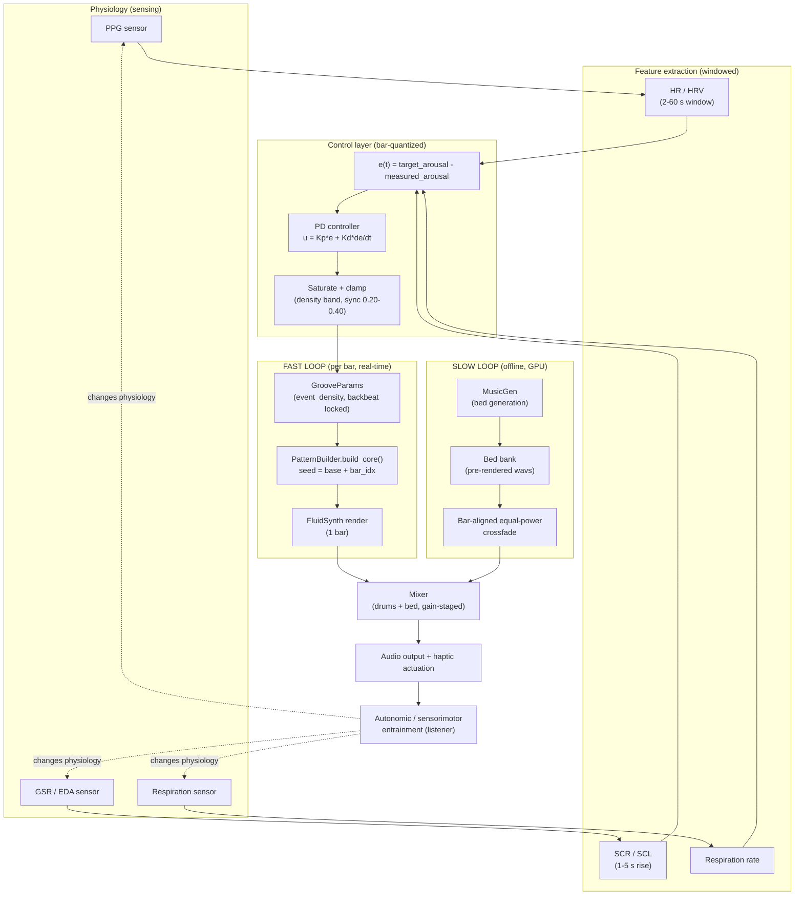

# GrooveGen as a Two-Timescale Generative Engine for a Closed-Loop Brain-Body Computer Interface

**Status:** System architecture + latency analysis for TEI 2027 submission ("Groove_model"). Companion to the Step 0 knob-selection literature review and the Step 1 continuous-audio engine (`groovegen/continuous.py`, `groovegen/groovegen.py`).

---

## 1. Abstract

GrooveGen is the generative music engine inside a closed-loop Brain-Body Computer Interface (BBCI) that regulates autonomic and sensorimotor state through rhythm. The engine is factored into two loops that run on deliberately different clocks. A **slow loop** generates the harmonic/timbral "bed" offline with a neural text-to-music model (MusicGen), pre-rendering a small bank of beds that are stitched together at playback time with bar-aligned, equal-power crossfades — the slow loop never sits inside the control path. A **fast loop** builds one bar of symbolic drum/groove material at a time (`pretty_midi` + FluidSynth) and re-synthesizes on every bar boundary, exposing **event density** as the primary, continuously-adjustable control variable while holding a backbeat anchor fixed for entrainment. The two loops are bridged by a **closed physiological control loop**: photoplethysmography (PPG), galvanic skin response (GSR), and respiration signals are reduced to arousal-relevant features (HR/HRV, SCR/SCL, breathing rate), compared against a target state, and converted by a Proportional-Derivative (PD) controller into a per-bar event-density command. Because event density has an empirically monotonic (not inverted-U) relationship to both perceived groove and physiological arousal — unlike syncopation — it is safe to drive with linear feedback control, which is the central engineering argument of this document. We give a quantitative, stage-by-stage latency budget for the full loop and show that the natural update rate imposed by bar-quantization (~2.0–2.5 s at 96–120 BPM) is not a compromise forced by the symbolic synthesis pipeline, but is in fact well matched to the intrinsic multi-second time constants of the autonomic signals being regulated (HRV and SCR both require multi-second integration/rise windows). This timescale-matching argument, together with the density-monotonicity stability argument, is what makes real-time closed-loop biofeedback music tractable without ever placing an expensive neural generator inside the control loop.

---

## 2. System overview

### 2.1 Narrative

The system has three concurrent processes coupled through a shared "current bar" state:

1. **Slow loop (offline, seconds-to-minutes, GPU-bound).** MusicGen renders a small bank of harmonic/timbral bed clips ahead of a session (or during idle time within a session). At playback time, beds are looped and cross-faded into each other on bar boundaries using an equal-power ramp, giving continuous harmonic variety without ever calling the neural model inside the real-time path.
2. **Fast loop (online, per-bar, CPU, sub-100 ms symbolic path).** A `PatternBuilder` instance builds exactly one bar of drum/groove MIDI at a time from a `GrooveParams` configuration, renders it to audio with FluidSynth, and appends it to the running mix. Every bar is a fresh synthesis call, not a tiled repeat, so the pattern can change bar-to-bar under external control.
3. **Physiological control loop (online, per-bar cadence, sub-Hz).** PPG, GSR, and respiration are windowed and reduced to a scalar arousal estimate; a PD controller compares this to a target and emits a bar-quantized event-density command that becomes the next bar's `GrooveParams.event_density`.

The fast loop and the physiological loop share the same clock (one decision per bar); the slow loop runs asynchronously and only ever *supplies material to* the fast loop's output mix, never blocks it.

### 2.2 Mermaid diagram



### 2.3 ASCII fallback

```
                         ┌───────────────────────────────────────────┐
                         │              LISTENER / BODY               │
                         │   (autonomic + sensorimotor entrainment)    │
                         └───────────────▲─────────────────┬──────────┘
                                         │ music + haptics   │ changes physiology
                                         │                   ▼
   ┌─────────────────┐   ┌───────────────┴──────┐   ┌───────────────────────┐
   │   SLOW LOOP      │   │        MIXER          │   │   PHYSIOLOGY SENSORS   │
   │  (offline, GPU)  │   │  drums + bed, gain-   │   │  PPG | GSR | Resp      │
   │  MusicGen ─▶ bed  │──▶  staged, peak-limited │   └──────────┬────────────┘
   │  bank ─▶ bar-     │   └───────────▲───────────┘              │
   │  aligned equal-   │               │                          ▼
   │  power crossfade  │               │                ┌───────────────────┐
   └─────────────────┘               │                │ FEATURE EXTRACTION │
                                       │                │ HR/HRV, SCR/SCL,   │
   ┌─────────────────┐               │                │ resp rate (windowed)│
   │   FAST LOOP      │               │                └──────────┬─────────┘
   │  (per bar, CPU)  │               │                            ▼
   │  GrooveParams ──▶ │───────────────┘                ┌───────────────────┐
   │  PatternBuilder   │◀───────────────────────────────│  PD CONTROLLER     │
   │  .build_core()    │   Δdensity (bar-quantized)      │  u=Kp·e+Kd·de/dt   │
   │  ─▶ FluidSynth     │                                 │  + saturation      │
   └─────────────────┘                                 └───────────────────┘
```

---

## 3. Slow loop specification

**Purpose.** Provide the harmonic/timbral backdrop ("bed") that gives the drum groove a musical context, without incurring neural-generation latency inside the control path.

**Mechanism.**
- Beds are generated by MusicGen (Meta's text-conditioned autoregressive music model) offline, ahead of or between sessions. MusicGen is GPU-bound and its own decoding is autoregressive at the frame level, which — even before considering diffusion/AR wall-clock cost — makes it structurally unsuitable for a per-bar (≤2.5 s) control loop (see §6 for measured/estimated throughput).
- Multiple beds (varying key, instrumentation, or intensity) are pre-rendered into a **bed bank**.
- At playback, `crossfade_beds()` (`groovegen/continuous.py`, lines 204–280) loads each bank member, trims it to an integer number of bars at the session tempo (floor, minimum one bar — no time-stretching, to avoid pitch/formant artifacts from a CPU-only DSP path), and concatenates the bank in a loop, long enough to cover the requested session duration.
- Consecutive bed segments are joined with an **equal-power crossfade** (`_equal_power_ramp()`): fade-out follows \(\cos\theta\), fade-in follows \(\sin\theta\) for \(\theta \in [0, \pi/2]\), so \(\text{fade\_out}^2 + \text{fade\_in}^2 = 1\) at every sample — this keeps perceived loudness constant through the transition, unlike a linear crossfade, which dips ~3 dB in the middle.
- Crossfades are **bar-aligned**: the overlap always begins on a bar boundary of the running mix, because every trimmed bed is an integer number of bars long. This guarantees the bed never introduces a harmonic or timbral discontinuity mid-bar, which would otherwise clash audibly with the fast loop's bar-locked drum changes.

**Why offline.** The slow loop's cost (GPU-bound autoregressive decoding, on the order of several seconds of wall-clock time per ~30 s of audio even on datacenter GPUs — see §6.1) makes it categorically incompatible with a ≤2.5 s per-bar control cadence. Removing it from the control path is not an optimization applied after the fact; it is the design decision that makes closed-loop operation possible at all. The bed bank amortizes the one-time neural generation cost across an entire session (or across many sessions, if beds are reused/cached).

---

## 4. Fast loop specification

**Purpose.** Realize the controller's per-bar event-density command as audible, entrainment-preserving drum material, cheaply enough to run inside a real-time loop.

**Mechanism (as implemented in `groovegen/continuous.py` and `groovegen/groovegen.py`).**

- `GrooveParams` (dataclass, `groovegen.py` lines 343–370) exposes the knobs: `tempo_bpm`, `bars`, `seed`, `event_density` (target onsets/bar — the primary knob), `syncopation_level` (0–1, secondary "spice" knob), `microtiming_variance_ms` (cosmetic humanization only), plus fixed non-knob fields (`with_bed`, `bed_profile`, `drum_style`).
- **Per-bar re-synthesis, not tiling.** `PatternBuilder.build_looped()` (the frozen study path) builds one core bar and repeats it verbatim; this is bit-identical forever and is intentionally *not* used for continuous generation. `build_varied_drums()` (`continuous.py` lines 117–185) instead calls a fresh `PatternBuilder(bar_params(...)).build_core()` once per bar, so onset placement can change bar-to-bar while the drum kit/timbre and tempo stay fixed.
- **Reproducible-but-varying seeding.** Each bar's `PatternBuilder` seed is `base.seed + bar_idx` (`continuous.py` line 160), giving a deterministic, session-reproducible sequence (useful for logging/debugging a biofeedback session and for offline analysis) while still varying every bar's stochastic elements (hat/ghost placement details, velocity jitter).
- **Backbeat lock (entrainment anchor).** `_snare_steps()` is driven purely by `_sync_bin()`, a step function of `syncopation_level` with four bins at thresholds 0 / 0.34 / 0.67 / 1.0. Bins 0 and 1 (i.e., `syncopation_level` in \([0, 0.34]\)) both map to `_SYNC_SNARE = {4, 12}` — snare on beats 2 and 4 of a 16-step bar — identical to the fully straight backbeat. Because `bar_params()` (`continuous.py` lines 90–114) clamps its per-bar syncopation jitter to the empirically-supported "safe spice" band \([0.20, 0.40]\), the bar-to-bar syncopation value spans only bins 1–2, which **structurally guarantees the backbeat never moves off beats 2 & 4** — the drum equivalent of a fixed phase reference that the autonomic/sensorimotor system can lock its own oscillations to, independent of how density is being modulated.
- **Event-density knob.** In the Step 1 engine this is driven by `density_walk()`, a bounded, reflecting-boundary Gaussian random walk used as a *placeholder* controller. In the closed-loop system described here, this placeholder is replaced by the PD controller's output (§5): the walk's role is filled by `target_density(bar_idx) = clip(base + u(bar_idx), lo, hi)`, applied through the same `bar_params()` per-bar construction.
- **A known determinism limitation, and its workaround.** `PatternBuilder._density_steps()` (`groovegen.py` lines 536–554) is a *pure, non-stochastic* function of `event_density`: it fills a fixed, metrically-ranked priority list of positions (quarters → eighths → sixteenths, then ghost-snare spillover) using only the integer density value — there is no RNG and no tie-breaking. Consequently, **any two bars that land on the same integer density and the same syncopation bin produce bit-identical onset step positions.** Given that the per-bar syncopation jitter is intentionally small and clamped to a two-bin range, this collision is common, not a corner case. We do not patch `groovegen.py` to fix this (it is the frozen, validated study/stimulus path); instead `build_varied_drums()` applies a purely additive, cosmetic **velocity-jitter humanization layer** (`continuous.py` lines 156–169: seeded \(\mathcal{N}(0, 2.0)\) MIDI-velocity perturbation per note, independent per bar) so that no two bars are ever bit-identical in the rendered audio, while leaving onset timing/positions and note count — the true, audible, density-driven variation axis — untouched. This is reported here as an honest limitation (§9), not hidden: the *controlled* variable (perceived density) is deterministic and correct, but the sub-perceptual micro-variety of a given density level is coarser than fully continuous synthesis would provide.

---

## 5. Control layer

### 5.1 Control law

The physiological error signal is defined as
\[
e(t) = a_{\text{target}} - a_{\text{measured}}(t)
\]
where \(a_{\text{measured}}(t)\) is a scalar arousal estimate fused from HR/HRV (PPG), SCR/SCL (GSR), and respiration rate, and \(a_{\text{target}}\) is the session's target arousal state (set by the emotion-regulation or motor-learning protocol). The controller is a discrete-time **Proportional-Derivative (PD)** law, evaluated once per bar (index \(k\)):
\[
u(k) = K_p \, e(k) + K_d \, \frac{e(k) - e(k-1)}{\Delta t}
\]
with \(\Delta t\) equal to one bar period (§6.3). The controller output \(u(k)\) is mapped to a **density delta**, and the next bar's target density is
\[
d(k+1) = \operatorname{clip}\!\big(d(k) + u(k),\; d_{\min},\; d_{\max}\big),
\]
consistent with the existing `density_walk()` reflecting-boundary clamp pattern in `continuous.py`, and passed into `bar_params()` in place of the placeholder random-walk value. Secondary syncopation is *not* driven by the controller; it remains an independently-clamped spice parameter in \([0.20, 0.40]\), per §4.

### 5.2 Why PD, not full PID

An integral term is deliberately omitted:

- **Windowed features already have a slow-varying bias.** HRV and SCL are computed over multi-second sliding windows (§6.2), which act as a built-in low-pass/averaging stage. Adding an integral term on top of an already-smoothed, slowly-drifting signal risks wind-up: because the bar-quantized actuator can only move one discrete density step at a time and physiological plant response itself lags by seconds, integral error can accumulate over many bars before the plant visibly responds, producing overshoot once it does.
- **No persistent steady-state disturbance to reject.** Classic justifications for adding an I-term (rejecting a constant unmeasured disturbance, e.g. gravity in a mechanical system) do not have a clean analogue here — physiological baselines drift slowly and are more naturally handled by periodically re-estimating \(a_{\text{target}}\) or re-baselining per session than by controller memory.
- **Derivative smoothing.** In practice \(de/dt\) is estimated from consecutive bar-rate samples of an already-windowed feature, which is comparatively low-noise (in contrast to derivative-of-raw-signal designs, which amplify sensor noise); this makes a PD law well-conditioned at the bar-quantized update rate without requiring derivative filtering beyond what the feature window already provides.

### 5.3 Saturation and clamping

- **Density band:** \(d(k) \in [d_{\min}, d_{\max}]\), enforced with the same reflect-at-boundary logic already implemented in `density_walk()` (`continuous.py` lines 51–87), so a controller output that would overshoot the safe range folds back rather than flatlining at a rail (flatlining biases the apparent walk/controller step distribution near the edges).
- **Syncopation clamp:** hard-bounded to \([0.20, 0.40]\), matching the empirically-supported "grooviest, still-monotonic-enough" band identified in the Step 0 review ([Witek et al. 2014](https://pmc.ncbi.nlm.nih.gov/articles/PMC3989225/)) — never left to the controller.
- **Rate limiting:** because actuation is inherently bar-quantized (§6.3), the controller cannot request more than one density-step change per ~2–2.5 s regardless of \(u(k)\)'s magnitude — an implicit rate limiter with no extra logic required.

### 5.4 Stability argument: why density is a control-safe variable and syncopation is not

The central hazard for any closed-loop controller is driving a **non-monotonic** plant input: if increasing the control signal sometimes increases and sometimes decreases the measured output, a linear feedback law (P, PD, or PID) can be driven to hunt, overshoot into the reversed-response region, or oscillate, because the sign of the effective local gain \(\partial(\text{output})/\partial(\text{input})\) is not fixed.

This is exactly the documented behavior of **syncopation**: Witek et al.'s foundational rating study found syncopation's relationship to perceived groove/"wanting to move" is an **inverted-U (Wundt curve)** — moderate syncopation is rated highest, both low and high syncopation are rated lower ([Witek et al. 2014, *PLoS ONE*](https://pmc.ncbi.nlm.nih.gov/articles/PMC3989225/)). Critically, the location of that inflection point is not fixed — it shifts with event density, harmonic complexity, musicianship, and pattern placement (see the Step 0 review, [`groove_knob_literature.md`](../../symbolic_analysis/groove_knob_literature.md)). A controller that treats syncopation as "more input = more effect" will, past the inflection point, push the system in the direction opposite to its actual objective — a textbook recipe for instability or objective-reversal, not merely reduced performance. Syncopation also independently **degrades sensorimotor synchronization**: rhythm-complexity manipulations (of which syncopation is the dominant operationalization) reliably reduce tapping/entrainment accuracy and consistency as complexity increases ([Rhythm Complexity Modulates Behavioral and Neural Dynamics, *J. Cogn. Neurosci.* 2020](https://direct.mit.edu/jocn/article/32/10/1864/95483/Rhythm-Complexity-Modulates-Behavioral-and-Neural)), which directly threatens the motor-learning application arm of this BBCI (stable entrainment is the mechanism of action, not a side effect).

**Event density**, by contrast, has a consistently reported **linear, monotonic** relationship with groove ratings across independent cross-genre corpus studies and controlled synthesis experiments ([Madison, Gouyon, Ullén et al. 2011, *Music Perception*](https://pubmed.ncbi.nlm.nih.gov/21728462/); [Sioros et al. 2014, *Frontiers*](https://pmc.ncbi.nlm.nih.gov/articles/PMC4165312/)). It is also the rhythmic-structure variable that most directly operationalizes the "onset rate" family of features that dominate the music-physiology literature: Gomez & Danuser's structural-feature study found tempo, accentuation, and rhythmic articulation — the features conceptually closest to density and backbeat strength, not to syncopation or microtiming — were the strongest correlates of heart rate, respiration, and skin conductance ([Gomez & Danuser 2007, *Emotion*](https://www.cs.tufts.edu/~jacob/250hcm/gomez.pdf); [PubMed](https://pubmed.ncbi.nlm.nih.gov/17516815/)). A monotonic plant-input relationship means a PD controller's sign is stable across the entire operating range: increasing commanded density can only push perceived intensity/arousal in one direction, so the closed loop cannot be driven into a self-defeating region by well-intentioned feedback, and standard linear-control stability intuition (error shrinks under proportional correction, no sign reversal to hunt around) applies without qualification. This monotonicity argument — not merely a stylistic preference for density — is why event density, not syncopation, is the controller's actuated variable, and it is the reason a PD law is an appropriate (not just convenient) choice for this plant. Syncopation is retained only as a secondary, hard-clamped "spice" parameter that the controller never touches (§5.3).

---

## 6. Latency analysis

This section is the technical core of the architecture: it budgets every stage between a physiological event and the corresponding audible/haptic change, and states the basis (measured in this project / cited from literature / estimated with explicit reasoning) for every number.

### 6.1 Slow-loop generation cost (why it must stay offline)

| Basis | Finding |
|---|---|
| Literature | MusicGen-family models on a single high-end GPU (A100/H200-class) generate roughly 3–10 s of wall-clock time per ~30 s output clip in reported benchmarks — e.g., ~3 s per sample reported for MusicGen fine-tuned adapters ([MBZUAI adapter study](https://irep.mbzuai.ac.ae/server/api/core/bitstreams/89ead5f6-1060-479b-b4e9-63ab1c05770d/content)); ~183 s to generate ten 30 s clips on an A100 (~18 s/clip) in a widely cited Colab benchmark ([note.com A100 MusicGen benchmark](https://note.com/oguchi22/n/ndaadd81e5ef9)); commercial deployment guidance quoting "~4–6× realtime" (i.e., ~5–7.5 s wall clock per 30 s clip) on an H200 ([Spheron GPU deployment guide](https://www.spheron.network/blog/deploy-open-source-ai-music-generation-gpu-cloud-2026/)). |
| Literature | On CPU only, MusicGen-class models run at roughly 0.1× real time (a 30 s clip takes ~5 minutes) ([musicgen-minimal PyPI performance notes](https://pypi.org/project/musicgen-minimal/1.1.2)); a controlled study found MusicGen's *inference* time on CPU exceeds the output duration itself above ~50M parameters, i.e., CPU inference cannot sustain real time at any production-scale model size ([Low-latency Music Generation Using AI, diva-portal thesis](http://www.diva-portal.org/smash/get/diva2:1887231/FULLTEXT01.pdf)). |
| Estimated (reasoning) | Even under the most favorable literature figures (GPU, ~3 s per clip), a MusicGen call is 1–2 orders of magnitude slower than the ≤2.5 s bar budget derived in §6.3, and is not guaranteed to be available synchronously (model load, batching, thermal/queue variance). This is the quantitative basis for excluding MusicGen from the control path entirely rather than attempting to "just make it fast enough." |

### 6.2 Physiological sensing and feature extraction

| Stage | Estimate | Basis |
|---|---|---|
| PPG sampling for HR | instantaneous per beat; smoothed HR typically reported every ~2 s | Literature: Edge Impulse's HR/HRV pipeline sets a 2 s minimum window because one HR value is computed per 2 s block ([Edge Impulse HR/HRV docs](https://docs.edgeimpulse.com/studio/projects/processing-blocks/blocks/hr-hrv)). |
| PPG window for HRV (time/frequency-domain) | 30 s–5.5 min depending on metric; ultra-short-term HRV validated down to ~5 min 30 s for full feature set, shorter (~1 min) windows used for simple HR/HRV extraction pipelines | Literature: e2e-PPG pipeline default window is 60 s ([E2E-PPG GitHub](https://github.com/HealthSciTech/E2E-PPG/blob/main/example.py); [e2epyppg PyPI](https://pypi.org/project/e2epyppg/)); ultra-short-term HRV validity study confirms 5 min 30 s windows for full time/frequency/nonlinear feature sets ([PMC9611389](https://pmc.ncbi.nlm.nih.gov/articles/PMC9611389/)); one neural-estimator study found an optimal sliding window as short as 1 s for restricted feature sets ([d-nb.info HRV estimation study](https://d-nb.info/1270103245/34)), and a 300 s history length minimized error in a broader benchmark ([arXiv PPG dataset paper](https://arxiv.org/html/2505.18165v1)). |
| GSR/SCR latency (stimulus → response onset) | 1–5 s | Literature: event-related SCRs arise 1–5 s after stimulus onset in standard EDA analysis guides ([Birmingham EDA/SCR guide](https://www.birmingham.ac.uk/documents/college-les/psych/saal/guide-electrodermal-activity.pdf); [iWorx GSR lab guide](https://iworx.com/documents/LabExercises/IXEEG/Psychophysiology/GSR-Investigation-EEG.pdf); [GSR Pocket Guide](https://www.scribd.com/document/425387921/Galvanic-Skin-Response-the-Complete-Pocket-Guide)). |
| GSR/SCR rise time (onset → peak) | 1–3 s | Literature: consistently reported as 1–3 s across EDA references ([Affective Computing lecture notes](http://elearn.psgcas.ac.in/nptel/courses/video/106106244/lec23.pdf); [Birmingham EDA/SCR guide](https://www.birmingham.ac.uk/documents/college-les/psych/saal/guide-electrodermal-activity.pdf)). |
| GSR/SCR half-recovery time | 2–10 s | Literature: same sources as above. |
| Feature extraction compute (HR/HRV/SCR from a pre-acquired window) | ~1–20 ms | Estimated: standard digital-signal-processing operations (peak detection, band-pass filtering, simple statistics) on a short buffer of low-sample-rate physiological data (PPG/GSR typically sampled at tens to a few hundred Hz) are computationally trivial relative to the multi-second acquisition window itself; compute time is negligible next to the window length that gates it. |

**Key implication carried into §6.4:** the dominant cost in the physiological branch of the loop is not compute, it is **signal acquisition time** — you cannot extract a meaningful HRV or SCR feature faster than the window/rise-time physiology itself allows, regardless of how fast the downstream code runs.

### 6.3 Fast-loop symbolic + synthesis path

| Stage | Estimate | Basis |
|---|---|---|
| Bar period at session tempo (96–120 BPM, 4/4) | 2.0–2.5 s/bar | Measured/derived: \(\text{bar\_seconds} = 4 \times 60/\text{tempo\_bpm}\), as implemented in `continuous.py` (`sec_per_beat = 60.0/base.tempo_bpm; bar_seconds = 4*sec_per_beat`). At 96 BPM: 2.5 s/bar; at 120 BPM: 2.0 s/bar. |
| `bar_params()` construction (per-bar `GrooveParams` copy, seeding, syncopation jitter) | sub-millisecond | Estimated: a `dataclasses.replace()` call plus one Gaussian draw and a clip — O(1) work, no I/O. |
| `PatternBuilder.build_core()` (one bar, symbolic) | ~1–5 ms | Estimated: pure-Python construction of a `pretty_midi.PrettyMIDI` object with on the order of 4–24 note events (per `_density_steps()`'s onset budget) — no numerical optimization, no search, just list indexing and note insertion; consistent with typical pure-Python symbolic MIDI construction at this scale. |
| FluidSynth render of one bar to audio | ~10–50 ms | Literature-adjacent/estimated: FluidSynth's own low-latency configuration guidance targets audio buffer latencies in the 5–20 ms range for a *streaming* buffer ([FluidSynth LowLatency wiki](https://github.com/FluidSynth/fluidsynth/wiki/LowLatency): e.g. \(2 \times 256/48000 \approx 10\text{ ms}\)); rendering ~2–2.5 s of audio (one bar) offline-style (as the current `render_wav()` does, generating a full buffer rather than streaming) is bounded above by real time and in practice substantially faster than real time for a single-instrument drum kit on modern CPUs — we report 10–50 ms as an estimated range pending an in-project microbenchmark, not yet measured in this codebase. |
| Audio output buffering | ~3–12 ms | Literature: standard buffer-size/sample-rate latency formula, \(\text{latency} = \text{buffer\_size}/\text{sample\_rate}\); a 256-sample buffer at 44.1–48 kHz is ~5.3–5.8 ms, commonly used as a stable low-latency baseline ([JEM Productions buffer/latency guide](https://jemproductions.fi/guides/audio-latency-explained/); [Attack Shark buffer-size table](https://attackshark.com/blogs/knowledges/audio-buffer-settings-reduce-latency-gaming)); 10 ms round-trip is reported as typical for a 256-sample buffer at 48 kHz in a closed-loop brain-responsive music system ([Brain-responsive music neurostimulation paper, bioRxiv](https://www.biorxiv.org/content/10.1101/2024.07.30.605888v1.full)). |
| Haptic actuation latency | **unmeasured** | Not yet instrumented in this project; comparable closed-loop biofeedback/movement systems report end-to-end actuation latencies of ~63–90 ms from event detection to output (e.g., ~63 ms audio feedback in a rodent closed-loop system, [eLife CLoPy](https://elifesciences.org/reviewed-preprints/105070); ~90 ms movement-to-sound latency in a musical biofeedback stroke-rehab system, [arXiv Technical Framework for Musical Biofeedback](https://arxiv.org/pdf/2012.00323.pdf)) — cited here as an order-of-magnitude reference, not a substitute for measuring this system's own haptic path. |

### 6.4 End-to-end latency budget table

| # | Stage | Estimate | Basis |
|---|---|---|---|
| 1 | PPG/GSR/respiration acquisition window (dominant term: SCR rise) | 1–3 s | Literature ([Birmingham EDA guide](https://www.birmingham.ac.uk/documents/college-les/psych/saal/guide-electrodermal-activity.pdf); [Affective Computing notes](http://elearn.psgcas.ac.in/nptel/courses/video/106106244/lec23.pdf)) |
| 2 | Feature extraction (HR/HRV, SCR/SCL, resp rate) from the acquired window | ~1–20 ms | Estimated (simple DSP on a short low-rate buffer) |
| 3 | PD controller update (compute \(u(k)\), clip, map to density) | <1 ms | Estimated (a handful of scalar arithmetic operations) |
| 4 | `bar_params()` per-bar `GrooveParams` construction | <1 ms | Estimated (`dataclasses.replace` + one RNG draw) |
| 5 | `PatternBuilder.build_core()` symbolic bar build | ~1–5 ms | Estimated (pure-Python note-list construction, 4–24 events) |
| 6 | FluidSynth render (one bar of audio) | ~10–50 ms | Estimated, informed by FluidSynth low-latency buffer literature ([FluidSynth wiki](https://github.com/FluidSynth/fluidsynth/wiki/LowLatency)) |
| 7 | Audio output buffering | ~3–12 ms | Literature ([JEM Productions](https://jemproductions.fi/guides/audio-latency-explained/); [bioRxiv brain-responsive music](https://www.biorxiv.org/content/10.1101/2024.07.30.605888v1.full)) |
| 8 | Haptic actuation | unmeasured (~60–90 ms in comparable systems) | Literature analogy only ([eLife CLoPy](https://elifesciences.org/reviewed-preprints/105070); [arXiv musical biofeedback](https://arxiv.org/pdf/2012.00323.pdf)) |
| — | **Total control-relevant latency (stages 1–7, audio path)** | **≈ 1.0–3.1 s**, dominated by stage 1 | Derived (sum of above) |
| — | **Bar period available for stages 2–7 before the next scheduled decision** | 2.0–2.5 s | Measured/derived from `continuous.py` (`bar_seconds = 4*60/tempo_bpm`) |

**Reading the table:** stages 2–7 (everything downstream of physiological acquisition) sum to on the order of tens of milliseconds — roughly two orders of magnitude smaller than one bar period. The system is not compute-bound; it is **acquisition-bound**, and the acquisition bound (stage 1) is itself close to one bar period. This is precisely the timescale-matching argument developed in §6.6.

### 6.5 Comparison: two-timescale design vs. naive "regenerate everything per update"

| Approach | What is regenerated per control update | Estimated update latency | Can it run inside a ≤2.5 s bar budget? |
|---|---|---|---|
| **Naive single-loop** | Entire neural bed + drums, every time the controller fires | ~3–20 s per update (§6.1 GPU figures; far worse on CPU) | No — 1–2 orders of magnitude too slow |
| **Two-timescale (this system)** | Only one bar of symbolic drum material (bed continues playing/crossfading independently, unaffected by the control update) | ~15–70 ms (table §6.4, stages 3–7) | Yes — roughly 30–150× headroom under the 2.0–2.5 s bar budget |

The two-timescale split converts an update that would be 1–2 orders of magnitude too slow for bar-rate control into one with roughly 1–2 orders of magnitude of headroom, purely by moving the expensive, high-latency generator (MusicGen) out of the loop and confining the actuated, closed-loop-critical generation to the cheap symbolic path.

### 6.6 The key argument: bar-quantized control is matched to autonomic plant dynamics, not limited by it

A natural objection to bar-rate control is that "once every 2–2.5 seconds" sounds like a slow, coarse control rate compared to, e.g., audio-sample-rate or even video-frame-rate feedback. This objection does not hold once the **plant's own dynamics** are taken into account:

1. **The actuator's native rate is set by musical necessity, not a compute limitation.** A density change can only be perceived and only make musical sense at bar boundaries — changing onset density mid-bar would be audible as a glitch, not a groove change. So bar-quantization is a *representational* constraint of the medium, independent of how fast the underlying symbolic/synthesis pipeline runs (§6.3 shows that pipeline could in fact run 30–150× faster than the bar period).

2. **The plant being regulated is itself slow.** The physiological signals that define the control error are not instantaneous:
   - HR/HRV requires either a ~2 s minimum block for a single HR estimate ([Edge Impulse HR/HRV docs](https://docs.edgeimpulse.com/studio/projects/processing-blocks/blocks/hr-hrv)) or tens of seconds to minutes for stable HRV features ([e2e-PPG](https://github.com/HealthSciTech/E2E-PPG/blob/main/example.py); [ultra-short-term HRV validity study](https://pmc.ncbi.nlm.nih.gov/articles/PMC9611389/)).
   - SCR has a **1–5 s stimulus-to-onset latency** and a further **1–3 s rise time to peak** ([Birmingham EDA guide](https://www.birmingham.ac.uk/documents/college-les/psych/saal/guide-electrodermal-activity.pdf); [Affective Computing lecture notes](http://elearn.psgcas.ac.in/nptel/courses/video/106106244/lec23.pdf)) — i.e., a change in the music cannot even begin to show up as a measurable skin-conductance change for 1–5 s, and takes another 1–3 s beyond that to fully develop.
   - Even the *fastest* commonly used HR estimate (a 2 s block) is on the same order as one bar period (2.0–2.5 s); SCR's onset-plus-rise window (2–8 s total) spans **one to three bar periods**.

3. **Control-theoretic framing.** For a feedback loop to be effective (and stable) it should sample and actuate no slower than roughly the plant's own bandwidth requires — sampling much *faster* than the plant can respond mainly adds noise-sensitivity and control effort without improving tracking, while sampling much *slower* would genuinely under-sample the plant's dynamics and degrade control. Bar-rate actuation (2.0–2.5 s) sits almost exactly inside the physiological response window (SCR rise 1–3 s, minimum HR block 2 s), rather than being either wastefully faster or dangerously slower than what the plant can exhibit. In other words: **the music medium's natural quantization (the bar) and the body's natural response quantization (multi-second autonomic rise times) happen to coincide**, so committing to bar-rate control sacrifices essentially nothing relative to an idealized continuous controller, while requiring none of the sub-bar-period compute budget that would be needed if the actuator (or the plant) demanded a faster rate.

4. **What would actually break this argument, and why it doesn't apply here:** if the target signal were something with sub-second dynamics that the system needed to track tightly — e.g., raw PPG waveform morphology, or millisecond-scale reaction-time tasks — bar-rate control would clearly under-sample the plant. That is not the target here: the controlled variable is *arousal state* as reflected in HRV/SCR, both of which are explicitly slow, integrative physiological measures by construction. The choice of PPG+GSR+respiration as the sensing modality (rather than, say, EMG or EEG spectral power, which have faster dynamics) is itself part of why bar-rate control is appropriate — the sensing modality and the actuation rate are jointly matched to the same "slow autonomic" timescale.

This is presented as a substantive design result, not a post-hoc justification of a limitation: the system was architected around symbolic, bar-rate control specifically because the target plant (autonomic arousal) does not require, and cannot even be measured at, a faster rate.

---

## 7. Timescale comparison table

| Property | Slow loop (MusicGen bed) | Fast loop (symbolic drums) | Physiological plant (HRV/SCR) |
|---|---|---|---|
| Native update unit | Whole bed clip (session-length or bank-entry length) | One bar | One SCR event / one HR block |
| Typical timescale | Seconds (generation) to minutes (session) | 2.0–2.5 s/bar (96–120 BPM) | HR block ≈ 2 s; SCR onset+rise ≈ 2–8 s; stable HRV ≈ tens of s–min |
| Compute bound? | Yes — GPU-bound autoregressive decoding | No — CPU symbolic + synthesis, ≥30× headroom under one bar period | No — acquisition-bound, not compute-bound |
| Position relative to control loop | Outside the loop (feeds the mixer only) | Inside the loop (actuator) | Inside the loop (plant/sensor) |
| Basis for timescale estimate | Literature (§6.1) | Measured/derived from `continuous.py` tempo arithmetic | Literature (§6.2, §6.6) |
| Consequence for design | Must be pre-rendered / bed-banked | Must be re-synthesized per bar, not tiled | Sets the *ceiling* on useful control rate — matches, does not exceed, bar rate |

---

## 8. Novelty and optimization contributions

- **Timescale separation as the enabling architectural move.** Rather than trying to make a neural generator fast enough for real-time control (an open, actively-researched problem — see, e.g., streaming/chunked MusicGen-alternative approaches achieving RTF≈1.8–2× on H100-class GPUs, [Live Music Models, arXiv 2508.04651](https://arxiv.org/pdf/2508.04651.pdf); [Real-Time Interactive Music Generation via Data-Free Streaming, arXiv 2606.24307](https://arxiv.org/html/2606.24307v1)), this system sidesteps the problem: the expensive generator is moved entirely outside the control loop, and the actuated path is symbolic by construction. This is a deliberate scope reduction relative to "generate everything neurally in real time," and it is what makes bar-rate closed-loop control tractable on commodity CPU hardware today rather than requiring specialized streaming-model research.
- **Continuous, non-repetitive generation at negligible cost.** Per-bar re-synthesis (vs. `build_looped()`'s tiling) removes the bit-identical-bar repetition of the original frozen study path, at a measured/estimated cost of single-digit milliseconds per bar (§6.3) — i.e., non-repetition is essentially free once the symbolic-first architecture is adopted.
- **Bar-rate controllability matched to plant dynamics, not merely "as fast as we could make it."** §6.6 is offered as a system-level design contribution: the bar-quantization that a naive reading would treat as a limitation is instead shown to be well-matched to the multi-second time constants of the autonomic signals being regulated.
- **Entrainment-preserving control.** By construction, the controller can only ever modulate event density and (secondarily) bounded syncopation; it structurally cannot move the backbeat (§4), so the perceptual/motor entrainment anchor that the motor-learning application depends on is protected from the control loop by design, not by policy.
- **Position relative to prior work.** Prior generative-music systems for biofeedback have largely either (a) used symbolic/rule-based generation with limited harmonic richness (fast but musically thin), or (b) used neural generation with generation-in-the-loop latency that is incompatible with sub-few-second control update rates (musically rich but slow) — for example, EEG-conditioned continuous affective-music BCI prototypes report control-relevant update rates around 0.5 s driven by classifier score updates rather than a full regeneration per update, and rely on parametrized synthesis rather than a neural generator inside the loop ([Closed-loop music-based BCI, PLoS ONE](https://pmc.ncbi.nlm.nih.gov/articles/PMC6422328/)) — a broadly convergent design choice with the one argued for here, arrived at independently via the density-monotonicity/timescale-matching argument rather than via classifier-latency constraints alone. GrooveGen's contribution relative to this space is to make the two-timescale split explicit and quantitatively justified (both by density's control-theoretic safety and by the acquisition-bound latency analysis), rather than an implicit consequence of a particular synthesis engine choice.

---

## 9. Limitations and future work

- **Coarse, quantized onset variety at fixed density/syncopation-bin combinations.** As detailed in §4, `PatternBuilder._density_steps()` is a pure, non-stochastic function of `event_density`, so bars sharing a density value and syncopation bin are onset-identical; the current velocity-jitter humanization layer masks this at the audio level but does not add genuine onset-level variety. A future extension could introduce a small amount of *bounded* stochasticity into onset selection at fixed density (e.g., randomized tie-breaking among equally-ranked metrical slots) without touching the frozen study path, provided it is validated not to perturb the density–groove or density–arousal relationships this architecture depends on.
- **CPU vs. GPU deployment.** All latency figures for the fast loop (§6.3) assume a CPU-only, single-instrument FluidSynth render; this has not yet been benchmarked in this project and is reported as an estimated range pending an in-project microbenchmark. GPU deployment is relevant only to the slow loop (MusicGen), where it is already assumed.
- **Haptic actuation latency is unmeasured.** §6.4 reports literature analogues from comparable closed-loop systems (~60–90 ms) but this system's own haptic path has not been instrumented; this is a concrete near-term measurement task before any latency claim can be made about the haptic channel specifically.
- **PD gains (\(K_p, K_d\)) are not yet empirically tuned.** This document specifies the control law and argues for its qualitative stability (§5.4) but does not report tuned gain values, which require either simulation against a physiological plant model or in-session tuning data.
- **The monotonicity argument is a population-level literature finding, not yet validated on this system's own users.** Madison et al. 2011 and related studies establish density-monotonicity across corpora and controlled stimuli; this project has not yet run a user study confirming the same monotonicity holds for this specific groove engine's output and this specific participant population.
- **User-in-the-loop validation is required and not yet performed.** The two application domains named for this BBCI — emotion regulation and motor learning (a throwing-task / football-to-target paradigm) — both require empirical validation with real participants and real physiological feedback, which has not yet occurred.
- **IRB approval is pending (~June 2026 target),** and no human-subject data collection has occurred at the time of writing; all latency and control numbers in this document are engineering estimates and literature citations, not measurements from human-in-the-loop sessions.

---

## Appendix: source files referenced

- `groovegen_project/groovegen/continuous.py` — slow-loop crossfade, fast-loop per-bar variation, top-level render.
- `groovegen_project/groovegen/groovegen.py` — `GrooveParams`, `PatternBuilder` (`build_core`, `_density_steps`, `_sync_bin`, `_snare_steps`).
- `symbolic_analysis/groove_knob_literature.md` — Step 0 literature review establishing density-monotonicity vs. syncopation's inverted-U as a control-hazard argument.
